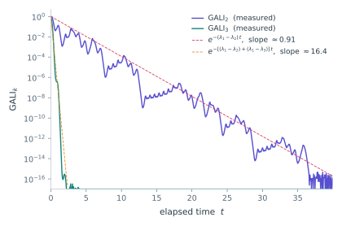

<span class="ts-kicker">Analysis · Chaos indicators</span>

# Chaos indicators

TSDynamics provides indicators based on tangent-vector alignment, a statistic
from a scalar observable and regional derivative-volume growth. Each
returns a result you can inspect. Their assumptions differ, so use independent
indicators and longer observation windows to cross-check a conclusion.

<figure markdown>
{ loading=lazy }
<figcaption>Solid curves show measured GALI₂ (indigo) and GALI₃ (teal) for a finite Lorenz trajectory. Dashed curves give asymptotic Lyapunov-gap references: $\lambda_1-\lambda_2 \approx 0.91$ and $(\lambda_1-\lambda_2)+(\lambda_1-\lambda_3) \approx 16.4$. Values below $10^{-17}$ are clipped at the display floor.</figcaption>
</figure>

| Function | Reads | Typical chaotic behavior | Regular reference / caveat |
|---|---|---|---|
| [`gali`](#gali-generalized-alignment-index) | tangent-vector volume | exponential decay | Hamiltonian tori: constant / power law; dissipative cycles can also decay exponentially |
| [`zero_one_test`](#the-01-test) | scalar $K \in [-1, 1]$ | $K \approx 1$ | $K \approx 0$ |
| [`expansion_entropy`](#expansion-entropy) | expansion entropy $H_0$ | asymptotic $H_0 > 0$ | check horizon, region and survivor statistics |

GALI and expansion entropy use the equations of deterministic ODEs or maps;
the 0–1 test can also use recorded scalar data. Cost and applicability depend
on state dimension, sampling and the selected observation window.

## GALI — Generalized Alignment Index

`gali` evolves $k$ deviation vectors along the orbit and tracks the volume of
the parallelepiped they span (Skokos, Bountis & Antonopoulos 2007). Written as
a wedge product of the normalised deviation vectors,

$$
\mathrm{GALI}_k(t) = \lVert \hat w_1(t) \wedge \dots \wedge \hat w_k(t) \rVert
    = \prod_{i=1}^{k} \sigma_i,
$$

it is the product of the singular values $\sigma_i$ of the matrix of deviation
vectors. For a **chaotic** orbit every vector rotates toward the
most-expanding direction, so the volume collapses **exponentially** at a rate
set by the leading Lyapunov gaps,

$$
\mathrm{GALI}_k(t) \sim
    e^{-[(\lambda_1-\lambda_2)+\dots+(\lambda_1-\lambda_k)]\,t}.
$$

For regular motion on a **Hamiltonian torus**, it stays $O(1)$ or follows a
power law whose exponent depends on the torus and phase-space dimensions.
A stable dissipative cycle can also align deviation vectors exponentially;
decay alone does not establish a positive leading Lyapunov exponent. Crucially
the deviation vectors are *not* re-orthonormalised — only
per-column renormalised — which is exactly what lets the spanned volume
actually shrink.

```python
import tsdynamics as ts

g = ts.analysis.gali(ts.systems.Lorenz(), 2, final_time=40.0, dt=0.05, ic=[1.0, 1.0, 1.0])

g.values[0], g.values[-1]   # ≈ 1.0  →  ~1e-16   (alignment collapse)
g.is_chaotic()              # True: legacy threshold heuristic, not a chaos verdict
g.decay_rate()              # ≈ 0.82  →  λ₁ − λ₂  (the Skokos law; lit. ≈ 0.906)
g.is_discrete               # False
```

The `GALIResult` carries the full decay curve — `g.k`, `g.times`, `g.values`,
`g.is_discrete` — and `float(g)` is the final value, so the result drops
straight into a threshold test. `g.decay_rate()` fits the log-slope over the
samples above the numerical floor to recover the exponent-gap sum, and
`g.is_chaotic()` thresholds the final value. That threshold is an alignment
indicator, not a general proof of chaos for every dissipative system. Note `k` is the second positional
argument, and must satisfy $2 \le k \le \dim$.

`ts.plot(g, "gali_curves")` displays the decay curve on log axes. A Hamiltonian
torus reference is opt-in: `frequencies=s` states the assumed torus dimension,
and `degrees_of_freedom=N` supplies half the phase-space dimension when the
result lacks that metadata. The guide uses the three-branch law of
[Skokos, Bountis & Antonopoulos (2008)](https://arxiv.org/abs/0802.1646), not
a fitted decay exponent.

```python
# GALI_3 on Lorenz: the second gap (λ₁ − λ₃ ≈ 15.5) is added on top, so it
# decays far faster — the teal curve in the figure above.
ts.analysis.gali(ts.systems.Lorenz(), 3, final_time=40.0, dt=0.05,
        ic=[1.0, 1.0, 1.0]).decay_rate()   # ≈ 18.4  (lit. gap sum ≈ 16.4)

# On a map GALI applies the Jacobian at each iterate:
ts.analysis.gali(ts.systems.Henon(), 2, n=60).is_chaotic()    # True
```

!!! note "GALI on a flow integrates its variational core"
    On a map, `gali` applies the Jacobian at each iterate. On a flow, vectors are advanced
    by the internal RK4 variational core, so it is slower. The measured decay
    rate of $\mathrm{GALI}_2$ on Lorenz ($\approx 0.82$ over this short orbit)
    approximates the Skokos-law gap $\lambda_1 - \lambda_2 \approx 0.906$ (with
    $\lambda_2 = 0$ along the flow); a short, un-renormalised horizon is a
    finite-time estimate, so it need not match the asymptotic gap. See
    [Lyapunov spectra](lyapunov.md) for the spectrum itself.

    GALI characterises a **specific** orbit, so an explicit `ic` that escapes
    the basin raises rather than being silently swapped for a random one — pass
    an `ic` from a known basin point, or omit it to roll (and, if it diverges,
    retry) a random one.

## The 0–1 test

`zero_one_test` uses a **single scalar observable** — no
phase-space reconstruction, no Jacobian at all (Gottwald & Melbourne 2004,
2009). For each of many random frequencies $c$ it drives a skew translation,

$$
p_c(n) = \sum_{j=1}^{n} \phi_j \cos(jc), \qquad
q_c(n) = \sum_{j=1}^{n} \phi_j \sin(jc),
$$

and measures the asymptotic growth of the mean-square displacement of
$(p_c, q_c)$. Regular dynamics keep the translation **bounded** (growth
$K_c \approx 0$); chaotic dynamics make it **diffuse** like a random walk
(linear growth, $K_c \approx 1$). The returned $K$ is the median of $K_c$ over
the frequencies, computed by the regularised correlation method of the 2009
paper.

```python
ts.analysis.zero_one_test(ts.systems.Logistic(params={"r": 4.0}), n=5000, ic=[0.1])   # ≈ 0.998  (chaotic)
ts.analysis.zero_one_test(ts.systems.Logistic(params={"r": 3.5}), n=5000, ic=[0.1])   # ≈ 0.0    (period-4 window)
```

The first argument may be a **system** — integrated (a flow) or iterated (a
map / Poincaré / stroboscopic view) internally to produce the observable — or a
bare 1-D series read directly (the *data* overload):

```python
x = ts.systems.Logistic(params={"r": 4.0}).run(steps=5000, ic=[0.1]).component("x")
ts.analysis.zero_one_test(x)          # ≈ 0.998   (the data overload — horizon keywords don't apply)
```

The test medians over `n_c` random drive frequencies drawn from `c_range`
(defaulting to the interval that avoids the resonances near $c = 0, \pi$); pass
`seed=` for a reproducible draw. The per-frequency values are available on
`result.distribution`; there is no separate return-shape flag. The `ZeroOneResult` is a drop-in for its $K$ value
and also carries the translation plane $(p_c, q_c)$ — a bounded blob for
regular motion, a diffusing cloud for chaos — which `result.plot()` renders as a
phase portrait. With `oversampling="resample"` (the default), a mean-crossing
heuristic may decimate an oversampled record; the stride is stored in `.meta`.
Use `"warn"` to inspect the original record with a warning, or `"ignore"` to
disable this guard. Check whether that heuristic suits your observable.

!!! warning "Check sampling and observational noise"
    The 0–1 test is designed for deterministic data. Oversampling a flow can
    obscure its growth statistic; compare several sampling intervals or use
    a Poincaré / stroboscopic view. Map iterates may also be correlated, so
    assess record length and sampling rather than assuming every iterate is
    suitable. Observational noise can push $K$ toward 1. Filtering changes the
    signal and is not a general correction: compare results with independent
    evidence before interpreting the statistic as chaos. The correlation method
    returns a Pearson coefficient, so $K \in [-1, 1]$ in principle (a regular
    orbit can give a small negative $K$). The result's `.chaotic` property uses
    conservative cutoffs: `True` at $K\geq0.8$, `False` at $K\leq0.2$, and
    `None` between them. These are interpretation heuristics, not proofs.

## Expansion entropy

`expansion_entropy` estimates **expansion entropy** $H_0$ from the growth of
a derivative-volume integral over a chosen region. Hunt & Ott relate it to
topological entropy under additional assumptions; smoothness alone does not
make it equal to the sum of positive Lyapunov exponents along an arbitrary
orbit. Those exponents describe a trajectory or invariant measure, while this
integral samples a whole restraining region. See the
[original paper](https://arxiv.org/abs/1501.07896). Writing
$G(A)$ for the product of the singular values of $A$ that exceed 1 (the volume
the linearised dynamics expand a unit ball into, restricted to expanding
directions),

$$
E(t) = \frac{1}{N}\!\!\sum_{\text{orbits staying in } S}\!\! G\big(DF^{t}\big),
\qquad H = \lim_{t\to\infty} \frac{\ln E(t)}{t},
$$

estimated by Monte-Carlo sampling $N$ initial conditions in a region $S$ and
reading $H$ off the slope of $\ln E(t)$ against $t$. Points that leave the
region are dropped, and the survivor count is reported.

A region is **one `(lo, hi)` pair per state component** — plain Python, no
library type to build (a `Box` / `Ball` / `Grid` from `ts.data` is still
accepted, it is simply never required):

```python
# Unit-height tent map: |f'| ≡ 2 everywhere ⇒ E(t) = 2^t ⇒ H = ln 2, exactly
ts.analysis.expansion_entropy(ts.systems.Tent(params={"mu": 1.0}),
                     [(0.0, 1.0)], n_samples=200, n=18).entropy
# ≈ 0.6931  ( = ln 2 )

# Hénon map: a finite-time expansion-entropy estimate
h = ts.analysis.expansion_entropy(ts.systems.Henon(), [(-1.6, 1.6), (-0.5, 0.5)],
                         n_samples=400, n=12)
float(h)              # ≈ 0.447   (h_top ≈ 0.465, Newhouse–Pignataro)
h.n_survivors, h.n_samples     # (295, 400) — how many stayed in S
```

The `region` is the second positional argument; omit it and the (10 %-expanded)
bounding box of a burn-in orbit is used. It **must** match the system
dimension. For a **flow** pass `final_time=` and `dt=` instead of `n=` (passing
`dt=` to a map raises — it has no meaning there):

```python
ts.analysis.expansion_entropy(ts.systems.Lorenz(), [(-20.0, 20.0), (-25.0, 25.0), (0.0, 50.0)],
                     n_samples=300, final_time=3.0, dt=0.1).entropy
# ≈ 1.16   (positive finite-time growth over this region and horizon)
```

The `ExpansionEntropyResult` carries `entropy`, `stderr`, the
`times` / `ordinate` curve, `n_samples`, `n_survivors` and `fit_region`.
`stderr` measures the line-fit residuals, not uncertainty from Monte-Carlo
sampling, integration or the choice of region. Check several sample counts,
regions and horizons before interpreting a positive finite-time slope as
evidence of asymptotic chaos. A ball remains a ball for sampling and survivor
tests; it is not replaced by its enclosing box.
As with every scaling estimate, inspect the growth curve and pass
`fit_range=(lo, hi)` to pin the linear region for a publishable number — a
short horizon keeps the raw (un-renormalised) tangent product from overflowing,
but too short a horizon leaves no scaling region.

## Known values

Every number here is reproduced by the calls on this page — the exact ones for
uniformly-expanding maps, the approximate ones for chaotic attractors.

| System | Quantity | Value | Source |
|---|---|---|---|
| Logistic, `r = 4` | `zero_one_test` | $K \approx 1.0$ | run above |
| Logistic, `r = 3.5` | `zero_one_test` | $K \approx 0$ | run above (period-4 window) |
| Tent, `μ = 1` | `expansion_entropy` | $\ln 2 \approx 0.693$ | run above (exact) |
| Hénon (defaults) | `expansion_entropy` | $\approx 0.447$ | run; lit. $h_{\text{top}} \approx 0.465$ |
| Lorenz | $\mathrm{GALI}_2$ decay | $\lambda_1 - \lambda_2 \approx 0.82$ | run above; lit. $\approx 0.906$ (Skokos law) |

## See also

- [Lyapunov spectra](lyapunov.md) — rates of infinitesimal perturbation growth along an orbit
- [Recurrence & RQA](recurrence.md) — recurrence geometry and line statistics
- [Fixed points & periodic orbits](fixed-points.md) — invariant sets and their linear stability

## References

- Skokos, Bountis & Antonopoulos, "Geometrical properties of local dynamics … the Generalized Alignment Index (GALI) method", *Physica D* **231** (2007) 30.
- Gottwald & Melbourne, "A new test for chaos in deterministic systems", *Proc. R. Soc. Lond. A* **460** (2004) 603.
- Gottwald & Melbourne, "On the implementation of the 0–1 test for chaos", *SIAM J. Appl. Dyn. Syst.* **8** (2009) 129.
- Hunt & Ott, "Defining chaos", *Chaos* **25** (2015) 097618.
