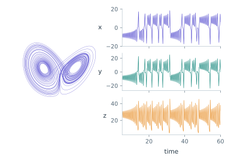

<span class="ts-kicker">Analysis · Integration & methods</span>

# Integration & methods

Use `run` to simulate a system. This guide explains the resulting `Trajectory`,
output sampling, solver and tolerance choices, automatic stiffness selection
and execution backends. A capability table lists the built-in solvers.

<figure markdown>
{ loading=lazy }
<figcaption>One <code>Lorenz().run(...)</code> call returns one <code>Trajectory</code>. The same data is the strange attractor in state space (left, indigo) and the stacked <code>x(t)</code>, <code>y(t)</code>, <code>z(t)</code> time series it samples on the output grid (right) — <code>traj.y</code> is <code>(T, dim)</code>, <code>traj["x"]</code> is one column of it.</figcaption>
</figure>

## Simulating with `run` {#one-verb-run}

Continuous families (ODEs, DDEs, SDEs) integrate in time; discrete maps iterate.
Both use `run` and return a [`Trajectory`](index.md).

```python
import tsdynamics as ts

# flows — integrate over a time span, sampled on an output grid
traj = ts.systems.Lorenz().run(final_time=100.0, dt=0.01)

# maps — iterate a fixed number of steps
orbit = ts.systems.Henon().run(steps=10_000)
```

For an adaptive ODE solver, internal steps are chosen using `rtol` and `atol`;
`dt` controls the returned sampling grid. Coarse output can still miss events
or bias analyses performed on the saved data. For fixed-step ODE and SDE
solvers, `dt` is also the numerical step. DDE integration has its own step and
history-resolution constraints, so assess convergence there too.

## The `Trajectory` object

Each single-system `run` returns a `Trajectory`: time points `t` of
shape `(T,)`, states `y` of shape `(T, dim)`, and provenance. Ensembles return a
batch of trajectories. Model-based analyses such as equilibrium
searches need the equations instead; `ts.analysis.find(traj)` lists the analyses
that accept measured data.

```python
traj.t, traj.y               # the arrays: (T,) and (T, dim)
traj.dim, traj.n_steps       # 3, 10001
t, y = traj.unpack()         # the two arrays in one go

traj["x"]                    # named component → (T,)   (needs class `variables`)
traj["x", "z"]               # several names → a Trajectory that names its own columns
traj[100:200]                # row slicing → new Trajectory (t and y together)
traj.component(2)            # by index

traj.after(20.0)             # drop the transient: keep t >= 20
traj.minmax()                # per-component (minima, maxima)
traj.standardize()           # zero mean, unit std per component (records the transform)
traj.neighbors(traj.y[0], k=3)   # the k nearest .state / .distance / .index (cached KD-tree)
```

Slicing keeps `t` and `y` together and preserves the metadata, so a
transient-dropped or windowed trajectory is still a fully self-describing
`Trajectory`. `traj.meta` carries the provenance — the system name, a snapshot of
the parameters, the solver, the tolerances, the backend, and the actual initial
condition used:

```python
traj.meta
# {'system': 'Lorenz', 'params': {...}, 'tsdynamics': '<version>', 'engine': 'rust',
#  'family': 'ode', 'method': 'rk45', 'backend': 'jit', 'dt': 0.01, 't0': 0.0,
#  'rtol': 1e-09, 'atol': 1e-12, 'ic': array([...])}
```

Save the metadata with the arrays to retain the inputs needed to repeat a run.

## The stepping API

`run` produces a whole trajectory in one call. For algorithms
that need *control* — advance a little, look at the state, decide, advance again
— every system also implements the incremental `System` protocol:

```python
lor = ts.systems.Lorenz()
lor.reinit([1.0, 1.0, 1.0])      # explicit start (optional — step() lazily reinits)
u = lor.step(0.01)               # advance dt=0.01, get the new state
lor.state(), lor.time()          # current state / time
lor.set_state(u + 1e-9)          # overwrite the state in place
```

- **`step(n_or_dt)`** — a number of iterations for maps (default 1), a time
  increment for flows (default `0.01` for ODEs, `0.1` for DDEs). Returns the new
  state.
- **`reinit(u, *, t=..., params=...)`** — restart the internal stepper; parameter
  overrides are applied first.
- **`state()` / `time()` / `set_state(u)`** — read the live state and time, or
  overwrite the state in place.

!!! note "`set_state` on a DDE raises — by design"
    A delay system's instantaneous state is a *history function* over
    $[t - \tau_{\max},\, t]$, not a point, so overwriting it with a single vector
    is not meaningful. `DelaySystem.set_state` raises `NotImplementedError`; use
    `reinit(u)` to restart from a constant past instead. This is also why the
    Jacobian-free two-trajectory estimator (which needs `set_state`) excludes
    DDEs.

The protocol is what the rest of the toolkit is written against — orbit diagrams,
Poincaré maps and the two-trajectory Lyapunov estimator are all loops over
`step()`. When a prepackaged
analysis does not fit, you drive it directly; see
[the Analysis toolkit](index.md#beyond-the-prepackaged-routines).

## Choosing a solver

The **`solver=`** keyword selects the integration kernel. The usual ODE default is `rk45`
(Dormand–Prince 5(4)), a robust general-purpose adaptive explicit solver that
serves most non-stiff systems well.

!!! note "`solver=` picks a kernel; `method=` picks an estimator"
    `solver=` is a keyword of `run` / `reinit` /
    `ensemble`; `method=` selects an *estimation algorithm* on an analysis
    (`optimal_delay(x, method="mi")`, `fixed_points(sys, method="interval")`).
    `run(method=...)` raises and names `solver=`.

The integrating field analyses `ftle_field`, `escape_time_field` and
`transient_time_field` also accept `solver=`. Omit it to use the model's declared
default, including stiff defaults. Their older `method=` spelling remains
accepted for compatibility; supplying both is an error.

```python
field = ts.analysis.ftle_field(
    ts.systems.Lorenz(), xlim=(-2, 2), ylim=(-2, 2), grid=12,
    final_time=0.2, solver="dop853",
)
```

For a higher-dimensional model, FTLE on this two-coordinate initial slice uses
stretching into **all** final state coordinates. It measures the largest
stretch within the chosen initial plane, which need not equal the largest
stretch over every possible initial direction.

For `escape_time_field` and `transient_time_field`, `t0=` sets the forcing clock
at launch, while `final_time=` remains the elapsed horizon and returned values
are elapsed first-passage times. The default transient arrival test evaluates
the actual speed at each checkpoint; `settled=` supplies a custom state test.

```python
# skip-doctest — `sys` is any continuous system of yours
traj = sys.run(final_time=100.0, dt=0.02, solver="dop853", rtol=1e-9, atol=1e-12)
```

There are three broad regimes:

- **Fixed-step explicit** (`euler`, `rk4`, `ssprk3`, …) — no error control; the
  step *is* `dt`. Cheap and fully deterministic, the right choice when you want
  a specified, reproducible discretisation (the Poincaré crossing march and the
  three.js viewers integrate on a fixed-step `rk4` for this reason). The
  trade-off is that you own the step: too coarse and the orbit drifts.
- **Adaptive explicit** (`rk45`, `tsit5`, `dop853`, …) — embedded error
  estimators shrink and grow the internal step to hold `rtol`/`atol`. The
  default regime for smooth, non-stiff dynamics. Reach for `dop853` when you
  need high accuracy at tight tolerances (e.g. reference Lyapunov runs).
- **Implicit / stiff** (`bdf`, `rosenbrock`, `trbdf2`, …) — solve a (possibly
  nonlinear) system each step using the Jacobian, so they stay stable on stiff
  problems where an explicit kernel would need a punishingly small step.
  `bdf` (variable-order 1–5) is the recommended stiff default. The engine builds
  the Jacobian-carrying tape automatically for these kernels — `solver="bdf"`
  uses the automatically derived Jacobian.

A system that is *known* to be stiff should declare `_default_method = "bdf"`
on its class, so it picks the right kernel without the caller having to know.
Several catalogue systems already do (e.g. `KuramotoSivashinsky`, `Duffing`).

!!! note "Tolerances tune accuracy, not the output grid"
    `rtol` / `atol` govern the **internal** adaptive steps. Tightening them
    refines the path the solver actually traces; it does not change where the
    result is sampled. To sample more densely, shrink `dt`.

### The default tolerances

| Surface | `rtol` | `atol` | Why |
| --- | --- | --- | --- |
| ODE `run` / `ensemble` / `step` / events / ODE Lyapunov | `1e-9` | `1e-12` | the library default |
| DDE `run` | `1e-3` | `1e-3` | the method of steps also limits internal steps using the sampling grid |
| DDE `lyapunov_spectrum` | `1e-7` | `1e-9` | same march, tighter for the variational renormalisation |
| basin cell march | `1e-6` | `1e-9` | thousands of two-node integrations for a *topological* classification |

These defaults are defined in `tsdynamics._utils.tolerances`. For a new model,
check that the observables of interest converge as you tighten tolerances and,
where relevant, reduce `dt`.

!!! info "ODE defaults changed in v6"
    The ODE defaults tightened from `rtol=1e-6, atol=1e-9` to
    `rtol=1e-9, atol=1e-12` when dense output separated the sampling grid from
    adaptive internal steps. Specify tolerances explicitly when reproducing an
    older run. Tighter tolerances reduce local integration error but do not
    guarantee long-term pointwise agreement for a chaotic trajectory.

## Automatic stiffness selection

If you do not know whether a system is stiff, ask the library to find out:

```python
# skip-doctest — `sys` is any continuous system of yours
traj = sys.run(final_time=100.0, dt=0.02, solver="auto")
traj.meta["method"]    # the kernel that was actually used, e.g. "rk45" or "bdf"
```

`solver="auto"` lowers the problem, probes the Jacobian spectrum at the start
state with the one-point `solvers.recommend` heuristic, and selects `bdf` on a
stiff right-hand side or `rk45` otherwise. The resolved kernel is recorded in
`traj.meta["method"]`, so the choice is always visible after the fact. It is
honoured consistently across every entry point — `run`, `ensemble`, the
resumable stepping protocol and event collection.

Because the probe is taken at a single point, it is **initial-condition
    dependent**: it is a heuristic, not a global stiffness test. A system you *know* to be
reliably stiff should still declare `_default_method = "bdf"` rather than lean on
`"auto"`. For maps, which have no solver kernel, `"auto"` is a harmless no-op.

## Backends: `jit`, `interp`, `reference`

Orthogonal to *which* solver runs is *what* executes it. The same `solver=` runs
on any of three backends, selected with `backend=`:

| `backend` | What it is | When to use it |
| --------- | ---------- | -------------- |
| `"jit"` | Cranelift compiles the expression tape to native code; **the default** | Repeated integration; compiled evaluators are cached |
| `"interp"` | The Rust expression-tape interpreter | Avoiding compilation for short runs or comparing execution paths |
| `"reference"` | Independent Python implementations for ODEs, SDEs and maps | Cross-validation; ODEs use SciPy |

```python
# skip-doctest — `sys` is any continuous system of yours
traj = sys.run(final_time=100.0, dt=0.01, backend="interp")
```

`jit` and `interp` evaluate the same tape and are tested for bitwise agreement
on a given platform. Cross-platform floating-point details may differ. The
independent `reference` implementation provides a numerical cross-check; it
does not support DDE integration.

## Solver capability table

Every solver lives in the solver registry — a `name → SolverSpec` table with
capability flags. The tables below list built-in solvers from
`tsdynamics._solvers.all_specs()`. Inspect that registry for installed plugin
solvers. (The `name` column is the exact `solver=` value; common
aliases such as `"RK45"` / `"dopri5"` resolve to `rk45`.)

<!--
  GENERATED TABLE — regenerate after adding/removing a solver with:

      from tsdynamics import _solvers as solvers
      for name, spec in solvers.all_specs().items():
          c = spec.caps
          print(name, c.kind, c.adaptive, c.needs_jacobian,
                sorted(c.supports), spec.description, spec.origin)

  Columns mirror SolverSpec / SolverCaps exactly — name, kind, adaptive,
  needs_jacobian, supports (family), description, origin. SolverSpec has NO
  order or stability field, so this table must not invent one (a kernel's
  order lives in its prose description, where the literature states it).
  Grouping below is editorial; the registry itself is unordered.
-->

### Explicit · fixed-step

| `solver` | Kind | Adaptive | Needs Jacobian | Family | Description | Origin |
| -------- | ---- | -------- | -------------- | ------ | ----------- | ------ |
| `euler` | explicit | — | — | ode | forward (explicit) Euler (order 1, fixed step) | builtin |
| `midpoint` | explicit | — | — | ode | explicit midpoint / modified Euler (order 2, fixed step) | builtin |
| `heun` | explicit | — | — | ode | Heun's method / explicit trapezoid (order 2, fixed step) | builtin |
| `ralston` | explicit | — | — | ode | Ralston's minimum-error-bound RK2 (order 2, fixed step) | builtin |
| `rk4` | explicit | — | — | ode | classic 4th-order Runge–Kutta (fixed step) | builtin |
| `rk4_38` | explicit | — | — | ode | the 3/8-rule 4th-order Runge–Kutta (fixed step) | builtin |
| `ssprk3` | explicit | — | — | ode | 3rd-order strong-stability-preserving RK (Shu–Osher, fixed step) | builtin |
| `ab3` | explicit | — | — | ode | Adams–Bashforth 3-step explicit multistep (order 3) | builtin |
| `ab4` | explicit | — | — | ode | Adams–Bashforth 4-step explicit multistep (order 4) | builtin |
| `abm4` | explicit | — | — | ode | Adams–Bashforth–Moulton predictor–corrector (PECE, order 4) | builtin |

### Explicit · adaptive

| `solver` | Kind | Adaptive | Needs Jacobian | Family | Description | Origin |
| -------- | ---- | -------- | -------------- | ------ | ----------- | ------ |
| `heun_euler` | explicit | yes | — | ode | Heun–Euler 2(1) adaptive | builtin |
| `bs3` | explicit | yes | — | ode | Bogacki–Shampine 3(2) adaptive (ode23) | builtin |
| `rk45` | explicit | yes | — | ode | Dormand–Prince 5(4) adaptive (dopri5) | builtin |
| `rkf45` | explicit | yes | — | ode | Runge–Kutta–Fehlberg 4(5) adaptive | builtin |
| `cashkarp` | explicit | yes | — | ode | Cash–Karp 5(4) adaptive | builtin |
| `tsit5` | explicit | yes | — | ode | Tsitouras 5(4) adaptive | builtin |
| `dop853` | explicit | yes | — | ode | Dormand–Prince 8(5,3) adaptive | builtin |

### Implicit / stiff

These solve a system each step using the Jacobian (`needs_jacobian = yes`); the
engine lowers the Jacobian-carrying tape automatically.

| `solver` | Kind | Adaptive | Needs Jacobian | Family | Description | Origin |
| -------- | ---- | -------- | -------------- | ------ | ----------- | ------ |
| `backward_euler` | implicit | yes | yes | ode | implicit (backward) Euler (order 1, L-stable) | builtin |
| `implicit_midpoint` | implicit | yes | yes | ode | implicit midpoint rule / 1-stage Gauss (order 2, A-stable) | builtin |
| `trapezoid` | implicit | yes | yes | ode | implicit trapezoidal rule / Crank–Nicolson (order 2, A-stable) | builtin |
| `sdirk2` | implicit | yes | yes | ode | 2-stage L-stable SDIRK (Alexander, order 2) | builtin |
| `rosenbrock` | implicit | yes | yes | ode | linearly-implicit Rosenbrock-W (one linear solve per step) | builtin |
| `trbdf2` | implicit | yes | yes | ode | TR-BDF2 composite ESDIRK (trapezoidal + BDF2) | builtin |
| `bdf` | implicit | yes | yes | ode | variable-order (1–5) fixed-leading-coefficient BDF | builtin |

### Stochastic (SDE)

Fixed-step schemes for diagonal-Itô SDEs. Here `dt` sets both the
discretisation and the noise scale $\sqrt{dt}$.

| `solver` | Kind | Adaptive | Needs Jacobian | Family | Description | Origin |
| -------- | ---- | -------- | -------------- | ------ | ----------- | ------ |
| `euler_maruyama` | explicit | — | — | sde | Euler–Maruyama diagonal-Itô (strong order 0.5) | builtin |
| `milstein` | explicit | — | yes | sde | Milstein with componentwise diffusion gₖ(Xₖ,t) (strong order 1.0; uses ∂gₖ/∂Xₖ) | builtin |

!!! note "Why there is no order or stability column"
    A `SolverSpec` carries only the capability flags shown above —
    `kind`, `adaptive`, `needs_jacobian`, and the supported `family`. It has no
    structured *order* or *stability* field, so this table does not fabricate
    one: a kernel's order and stability region are stated in its prose
    description, sourced from the original literature, rather than reduced to a
    column the registry cannot back.

## Self-documenting solvers

The registry is the single source of truth. Any solver — built-in or shipped by
a plugin — appears in `solvers.all_specs()` with its capability flags and
description, which is exactly what this table renders. A new kernel registered
through the solver registry therefore documents itself: it becomes selectable by
`solver=` and shows up here on the next docs build, with no separate
documentation step. The `origin` column distinguishes registry-`builtin`
kernels from out-of-tree contributions; today every solver is `builtin`.

## See also

- [Analysis toolkit](index.md) — the `Trajectory` object, the stepping protocol, and the quantifiers
- [Systems](../systems/index.md) — the 177 built-in systems you can integrate
