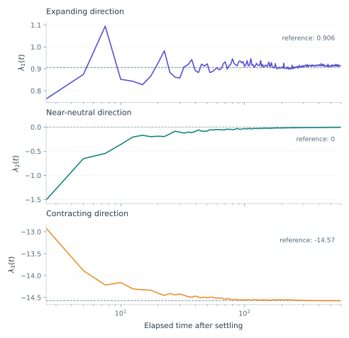

<span class="ts-kicker">Analysis · Lyapunov spectra</span>

# Lyapunov spectra

Lyapunov exponents describe how infinitesimal perturbations grow or shrink. Two
trajectories that start infinitesimally apart separate, on average, at
an exponential rate; the spectrum $\lambda_1 \ge \lambda_2 \ge \dots$ collects
those rates, one per direction in tangent space. A single positive exponent is
an indicator of sensitive dependence on a bounded invariant orbit. A finite-time
positive estimate can also reflect a transient, so compare longer windows and
check boundedness before interpreting it as asymptotic chaos. The signs
of the whole spectrum read like a fingerprint: how many directions expand, how
many are neutral, how fast phase-space volume contracts onto the attractor.

TSDynamics provides spectrum estimators for ODEs, maps and delay systems, a
Jacobian-free maximal estimator, an estimator for measured data and the
Kaplan–Yorke dimension derived from a suitable spectrum.

<figure markdown>
{ loading=lazy }
<figcaption>Each panel follows one running Lyapunov estimate after a settling
interval. The panels share a logarithmic time axis and use separate vertical
scales so the near-neutral rate remains visible. Dashed lines mark the reference
values <code>[0.906, 0.0, -14.57]</code>. Compare longer observation windows before
interpreting finite-time estimates as asymptotic rates.</figcaption>
</figure>

## The uniform entry point

`ts.analysis.lyapunov_spectrum(system, ...)` dispatches to the right family
implementation and translates one signature to each family's native keywords.
The exponents come back largest first, in a `LyapunovSpectrum` result that is a
drop-in for the bare exponent array — `np.asarray(result)`, indexing and
iteration all defer to it — while also carrying `.meta` and the `.kaplan_yorke`
dimension when enough exponents are available. Printing the result summarizes
the rates, any automatic classification and the model used.

```python
import numpy as np
import tsdynamics as ts

spec = ts.analysis.lyapunov_spectrum(ts.systems.Lorenz(ic=[1.0, 1.0, 1.0]),
                            final_time=300.0, dt=0.05, transient=40.0)
np.asarray(spec)      # approximately [0.9, 0.0, -14.6] for this finite window
spec.kaplan_yorke     # ≈ 2.06
print(spec)
# summarizes the rates, classification, Kaplan–Yorke dimension and system name
```

The keywords split cleanly by family: a **flow** (ODE or DDE) uses
`final_time=` as its averaging window and `transient=` as a burn-in *time*; a
**map** uses `n=` iterations and `transient=` as a count of discarded iterations
(500 by default). Tangent-vector reorthonormalization does not remove the
base orbit's transient. `k=` sets how many exponents to
compute (`dim` by default). Passing a map keyword to a flow — or the reverse —
raises rather than silently doing the wrong thing.

For ODEs and maps, the initial tangent directions are mixed and reproducible.
This avoids starting a leading-exponent calculation entirely inside a
contracting coordinate subspace. A finite run still needs a convergence check;
the choice of initial frame does not certify an asymptotic exponent.

Native and reference ODE tangent integrations stop with `ConvergenceError` if
the base orbit crosses both the shared absolute escape scale and growth factor.
The error reports the time and state magnitude; choose an initial condition in
a bounded basin before retrying. Large physical units alone do not trigger this
guard. For returned map, DDE, or older results, also inspect `result.unbounded`.

## Per family — what actually runs

The same function selects a family-specific tangent-space calculation. The
following examples show the time or iteration arguments each family requires.

=== "ODE (flow)"

    ```python
    lor = ts.systems.Lorenz(ic=[1.0, 1.0, 1.0])
    ts.analysis.lyapunov_spectrum(lor, final_time=300.0, dt=0.05, transient=40.0)
    # approximately [0.9, 0.0, -14.6] for this finite window
    ```

    The **extended variational system** — the state plus $k$ deviation
    vectors, whose dynamics are the right-hand side differentiated
    symbolically — is integrated on the Rust engine. After the `burn_in` the
    evolving frame is periodically **QR-reorthonormalised** (Benettin et al.
    1980); the logs of the diagonal $R$ factors, time-weighted, are the
    exponents. A bounded non-equilibrium orbit of an autonomous flow has a
    neutral direction *along* the flow. The finite-time estimate of this neutral
    exponent can lie on either side of zero.

=== "Map"

    ```python
    ts.analysis.lyapunov_spectrum(ts.systems.Henon(ic=[0.1, 0.1]), n=6000)
    # ≈ [0.42, -1.63]
    ```

    A single forward pass on the compiled tangent-map kernel: at each iterate
    the analytic Jacobian is applied to the deviation frame, which is
    **QR-reorthonormalised**, and the logs of $|\mathrm{diag}\,R|$ accumulate.
    The whole QR iteration runs in one Rust call, and divergent random initial
    conditions are retried automatically. The exponents are *per iteration*,
    not per unit time.

=== "DDE (delay)"

    ```python
    mg = ts.systems.MackeyGlass()
    hist = lambda s: [1.0 + 0.1 * np.sin(0.2 * s)]
    traj = mg.run(final_time=1000.0, dt=0.5, history=hist)   # settle first
    ts.analysis.lyapunov_spectrum(mg, k=1, dt=0.5, ic=traj.y[-1],   # then measure
                                  transient=100.0, final_time=1000.0,
                                  rtol=1e-4, atol=1e-4)
    # ≈ [0.0075]   (positive finite-time leading rate at τ = 17)
    ```

    A delay system has an **infinite-dimensional** tangent space (its state is
    a history function), so the estimator builds an *extended DDE* — the base
    state plus $k$ deviation states obeying the symbolic variational dynamics —
    and Benettin-renormalises over the deviation *history segment*. Because it
    restarts from a **constant past**, the workflow is two calls: integrate to
    the attractor, then hand the end state to `lyapunov_spectrum`. A DDE may
    request more exponents than `dim`. Check convergence with both the step bound
    `dt` and solver tolerances: delay interpolation and history resolution can
    affect the estimated rates as well as integration error. See
    [the tolerance table](integration-and-methods.md#the-default-tolerances).

Every call records its settings in `result.meta` — the horizon it actually used,
the family, the parameters and the initial condition.

!!! note "Interpreting signs and automatic classifications"
    Positive asymptotic exponents indicate expanding directions; two or more
    are commonly called hyperchaos for a bounded invariant state. Finite-time
    estimates require more caution. The automatic label uses a numerical
    tolerance heuristic and does not establish asymptotic behavior.

    For a multi-direction autonomous flow, the zero tolerance uses `min|λ|` as
    an empirical floor, alongside a relative floor. It is a heuristic, not a
    confidence interval: equilibria need not have a zero exponent, and a
    truncated spectrum may omit a neutral direction. Single-exponent estimates,
    maps, and explicitly forced systems use a relative floor. A single recorded
    flow direction leaves the automatic chaos verdict indeterminate: even a
    regular orbit can have positive finite-time growth from shear. Its numerical
    rate remains available. The supporting line reports which rule ran:

    ```
    LyapunovSpectrum  λ = [0.9038, -0.0003703, -14.57]   chaotic · D_KY = 2.062   (Lorenz)
        (3 exponents · flow (empirical zero floor) · λ > 0.0146)
    ```

    If the count changes when that floor is multiplied by ten, no word is
    printed — the result says `indeterminate at this horizon (n_pos = 0..1
    across a 10x tolerance band; raise final_time)`. Also,
    `D_KY` is omitted from the regime readout when no exponent is positive.
    A stable equilibrium has dimension zero; a regular cycle or torus has
    neutral directions, so there is no universal integer dimension for all
    regular spectra.

## Known values to test against

These are literature numbers you can reproduce with the calls above — the same
ones the bulk test suite checks continuously for every system that declares a
`known_lyapunov` class attribute.

| System | Spectrum | Note |
| ------ | -------- | ---- |
| Lorenz (defaults) | `[0.906, 0, -14.57]` | one zero exponent along the flow |
| Hénon (defaults) | `[0.42, -1.63]` | $\sum\lambda_i \approx \ln|\det J|$ (area contraction) |
| Logistic, `r = 4` | `[ln 2 ≈ 0.693]` | exact analytic result |
| Mackey–Glass, `τ = 17` | leading `> 0` | chaotic; $\ge 1$ positive exponent |

## Just the leading exponent — and no Jacobian required

Ask for one exponent, and you get one:

```python
ts.analysis.lyapunov_spectrum(ts.systems.Lorenz(), k=1, ic=[1.0, 1.0, 1.0])
ts.analysis.lyapunov_spectrum(ts.systems.Henon(), k=1, ic=[0.1, 0.1])
```

When the system has a right-hand side to differentiate, the exponents come from
a **tangent frame** carried alongside the orbit. The base trajectory is not
perturbed; the deviation vectors are repeatedly orthonormalized. When no
differentiable right-hand side is available — for example, a
[`WrappedSystem`](../start/defining-systems.md) around an external stepper, a
non-smooth map with no analytic Jacobian — `lyapunov_spectrum` falls back to the
classic **two-trajectory** method, which uses the stepping
protocol: run a reference and a copy perturbed by `d0`, let them separate for
`steps_per` protocol steps, log the growth $\ln(d/d_0)$, rescale back to `d0`,
and repeat (Benettin, Galgani & Strelcyn 1976). The continuous normalisation
divides by the *measured* elapsed `time()` of the reference run, so the exponent
has the correct time units even when a protocol step advances by a variable amount.

## `lyapunov_from_data` — from a measured series

Given a recording but no equations, the maximal exponent can be estimated from
how fast neighbours diverge inside a delay embedding. The signal is
reconstructed in a `dimension`-dimensional delay embedding (Takens 1981); for
every reference point its neighbours are found and the **mean log distance
between their forward images** is tracked as a function of the look-ahead $k$.
The result carries the full **stretching curve** $S(k)$ — the exponent is the
slope of its linear scaling region.

```python
traj = ts.systems.Henon().run(6000, transient=500, ic=[0.1, 0.1])
res = ts.analysis.lyapunov_from_data(traj.y[:, 0], dimension=4, k_max=12, fit=(0, 6))

float(res)          # ≈ 0.42   (Hénon, per iteration)
res.times, res.divergence     # the S(k) curve — inspect, then set fit=(lo, hi)
```

Two estimators are available via `method=`:

- `"kantz"` (default) averages over **all** neighbours within a ball of radius
  `eps`, reducing reliance on any single neighbour (Kantz 1994).
- `"rosenstein"` tracks the **single** nearest neighbour — cheaper, well-suited
  to short records (Rosenstein, Collins & De Luca 1993).

A Theiler window rejects temporally-correlated neighbours (Theiler 1986),
defaulting to the embedding span.

The exponent is reported **per unit of `dt`**, and `dt` is read from the data
when the data knows it: hand the estimator a `Trajectory` and it uses that
trajectory's own sampling interval, so the number is directly comparable with
`lyapunov_spectrum`. Hand it a bare array — which carries no time axis — and it
stays **per sample**, which is also the right reading for a map (per iteration).
Pass `dt=` explicitly to override either way.

!!! warning "Inspect the curve before you trust the number"
    The estimate is only as good as the embedding and the chosen scaling
    region. For flows the divergence curve typically *overshoots* before it
    settles into the genuine linear region, so the automatic fit can
    overestimate. Always look at `res.times` vs `res.divergence` and pass an
    explicit `fit=(lo, hi)` before quoting a publishable value.

## Kaplan–Yorke dimension

The Lyapunov (Kaplan–Yorke) dimension interpolates the balance between expanding
and contracting directions. Its relation to geometric attractor dimension is
conjectural and depends on the invariant measure; it is not a direct
box-counting measurement:

```python
ts.analysis.kaplan_yorke_dimension([0.906, 0.0, -14.57])   # ≈ 2.06  (Lorenz)
```

$$
D_{KY} = j + \frac{\lambda_1 + \dots + \lambda_j}{|\lambda_{j+1}|},
$$

with $j$ the largest index whose cumulative exponent sum is still non-negative
(Kaplan & Yorke 1979) — the interpolation point where expanding directions have
just been balanced by contracting ones. It returns `0.0` for a fully negative
spectrum (a stable fixed point). For a complete finite-dimensional spectrum
whose sum stays nonnegative, the result saturates at the state dimension.

A `LyapunovSpectrum` exposes it as `spec.kaplan_yorke`. That property is `nan`
when the supplied directions do not determine a dimension: a truncated
spectrum must reach a negative cumulative sum, and an explicitly forced
system needs its forcing phase in an autonomous extension. Passing such a
result to `ts.analysis.kaplan_yorke_dimension` raises an explanatory error.
A bare exponent array has no record of missing directions or forcing and
retains the mathematical edge convention `len(spectrum)` when no crossing
is present; keep the rich result when provenance matters.

## `TangentSystem` — build your own loop

When the prepackaged routines do not fit — covariant vectors, finite-time
exponents, custom convergence monitoring — the tangent system exposes the
tangent machinery as a steppable system, so you own the loop:

```python
from tsdynamics.derived import TangentSystem

tang = TangentSystem(ts.systems.Henon(), k=2)     # k deviation vectors
tang.reinit([0.1, 0.1])
for _ in range(5000):
    tang.step()
tang.exponents()      # running spectrum estimate ≈ [0.43, -1.63]
tang.growths()        # per-step log stretch factors
```

It is the single Lyapunov engine underneath every routine above: maps run the
compiled QR tangent-map kernel, ODEs integrate the extended variational system on
the engine, and DDEs are excluded (their tangent space is infinite-dimensional —
use `lyapunov_spectrum`). It is exactly the object the showcase figure at the top
of this page is built from.

## See also

- [Chaos indicators](chaos.md) — complementary alignment, signal-growth and expansion diagnostics
- [Fixed points & periodic orbits](fixed-points.md) — the invariant sets whose local stability the exponents generalise
- [Fractal dimensions](dimensions.md) — measure the attractor's dimension directly, to cross-check $D_{KY}$
- [Delay embeddings](embedding.md) — the reconstruction `lyapunov_from_data` relies on
- [Integration & methods](integration-and-methods.md) — the solver and backend `lyapunov_spectrum` runs on

## References

- G. Benettin, L. Galgani & J.-M. Strelcyn, "Kolmogorov entropy and numerical experiments", *Phys. Rev. A* **14** (1976) 2338.
- G. Benettin, L. Galgani, A. Giorgilli & J.-M. Strelcyn, "Lyapunov characteristic exponents … a method for computing all of them", *Meccanica* **15** (1980) 9 & 21.
- J. L. Kaplan & J. A. Yorke, in *Functional Differential Equations and Approximation of Fixed Points*, LNM **730**, Springer (1979) 204.
- H. Kantz, "A robust method to estimate the maximal Lyapunov exponent of a time series", *Phys. Lett. A* **185** (1994) 77.
- M. T. Rosenstein, J. J. Collins & C. J. De Luca, "A practical method for calculating largest Lyapunov exponents from small data sets", *Physica D* **65** (1993) 117.
