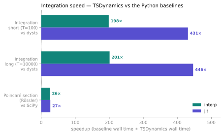
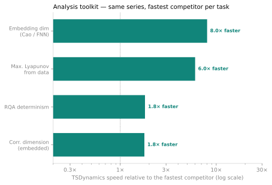

References · Benchmarks

# Benchmarks

These are recorded timing and numerical comparisons from TSDynamics **5.2.4**.
They compare selected integration and analysis tasks with Python libraries and
DynamicalSystems.jl on the environment below. They are a historical snapshot,
not measurements of the current release or a ranking for every workload.

Read timings alongside the task settings and numerical deviations. Matched
inputs help isolate an estimator, but methods can have different finite-sample
biases, stopping rules and mathematical guarantees.

<figure markdown>
{ loading=lazy }
<figcaption>Recorded best-of-N wall-time ratios for the stated workloads: the Rust engine (teal · <code>interp</code>, indigo · <code>jit</code>) integrates the Lorenz system in one dense call ~62–156× faster than SciPy and ~200–450× faster than dysts, and marches the Rössler Poincaré section ~26× faster than SciPy's event integrator.</figcaption>
</figure>

## Methodology

Every number on this page comes from a single full run of the cross-library
harness in the repository's `benchmarks/` folder. The methodology is designed to
make the inputs and timing procedure repeatable. Results can change with
hardware, compiler versions, library versions and system load.

- **Best-of-N wall time.** Each task is timed $N$ times and the minimum is
  recorded after a warm-up. This reduces the influence of some scheduling
  delays but does not quantify timing variability. One-time lowering and JIT
  compilation are excluded, so these are warm-run measurements, not startup
  timings.
- **The library's own code, each task.** The integration tasks each use the
  library's *own* integrator — that is the entire point of an integration
  benchmark. The from-data analysis tasks feed **every** library the *same*
  generated time series (dumped once, independently of any benchmarked library),
  so the comparison measures the estimator, not the input.
- **Matched settings across libraries.** Where a task has a tunable that changes
  the work done — the Lyapunov renormalisation interval, the fixed-point search
  method — TSDynamics is run with the **same** setting as the reference it is
  compared against (e.g. the Julia `Δt=0.1` renorm step, the same $[-2,2]^2$ box
  for fixed points). TSDynamics' numerical interval search and Julia's certified
  interval method have different guarantees: matching the search box and root
  values does not make their certification work equivalent.
- **Process isolation.** Every library runs in its own subprocess and writes a
  JSON record the orchestrator merges. A crash, a slow library, or an import
  side-effect cannot take the rest of the suite down, and each library gets a
  clean interpreter.
- **Precision against a tight reference.** Where a task has a comparison value — a
  literature Lyapunov estimate, an analytic fixed point, a $10^{-13}$ reference
  trajectory — the table reports both the estimate and its deviation $\Delta$ from
  that reference.

### The environment

| | |
|---|---|
| **Platform** | Linux x86-64 (`glibc` 2.43) |
| **Python** | 3.12.12 |
| **TSDynamics** | 5.2.4 (`interp` + `jit` backends) |
| **DynamicalSystems.jl** | 3.6.8 (Julia 1.12) |
| **NumPy** | `< 2.5` (pinned — numba, and therefore pynamical/nolitsa, does not yet build on NumPy 2.5) |

!!! note "Reproduce it yourself"
    The harness, adapters, frozen inputs and rendered tables all live under
    `benchmarks/` in the source tree. It runs out of a **dedicated** virtual-env
    so it never perturbs the project's own — see `benchmarks/README.md` for the
    one-time setup and the `run_benchmarks.py` invocations. The numbers below are
    the committed output of one full run; re-running on your own hardware will
    change both absolute times and relative performance.

### The libraries compared

Each library contributes what it is designed for; a library that does not provide
a capability leaves that cell **blank**.

| Library | Version | What it contributes to the comparison |
|---|---|---|
| **TSDynamics** (`interp` + `jit`) | 5.2.4 | the library under test — every task, both engine backends |
| **DynamicalSystems.jl** | 3.6.8 | the compiled-Julia reference — integration, Lyapunov, bifurcation, Poincaré, fixed points, basins, correlation dimension |
| **SciPy** | 1.18.0 | the integration baseline (`solve_ivp`), fixed points (`fsolve`), Poincaré (events) |
| **dysts** | 0.96 | a chaotic-systems catalogue on a SciPy integrator; correlation dimension (`gp_dim`), DFA |
| **pynamical** | 0.3.3 | the logistic-map bifurcation diagram (numba) |
| **nolds** | — | from-data correlation dimension, Rosenstein Lyapunov |
| **nolitsa** | — | from-data correlation dimension, MLE Lyapunov, FNN embedding dimension (numba) |
| **neurokit2** | 0.2.13 | broad from-data complexity — correlation dimension, RQA, embedding dimension |
| **pyunicorn** | 0.9.0 | recurrence quantification (RQA determinism) |

Two further libraries were evaluated but could not be run in this environment,
and are recorded here for completeness: **PyDSTool** (does not import on
NumPy ≥ 2 — the removed `numpy.distutils`) and **TISEAN** (legacy C/Fortran CLI
tools that do not build with the current toolchain).

## Integration speed

The core task. Integrate the Lorenz system with DOP853 at `rtol=atol=1e-9` and
return the trajectory. dysts and DynamicalSystems.jl join the integration rows;
the from-data-only Python libraries correctly leave these cells blank.

| Task | TSDynamics `interp` | TSDynamics `jit` (default) | SciPy | dysts | DynamicalSystems.jl |
|---|---:|---:|---:|---:|---:|
| Integration — short ($T=100$) | **7.78 ms** | **3.58 ms** | 480.47 ms | 1.544 s | 1.72 ms |
| Integration — long ($T=10000$) | **780.08 ms** | **351.24 ms** | 54.921 s | 156.802 s | 196.03 ms |
| Poincaré section (Rössler, $y=0$) | **202.93 ms** | 198.11 ms | 5.306 s | — | 14.11 ms |

Reading the ratios:

- **vs Python:** short integration is **134×** faster than SciPy on the default
  `jit` backend (**62×** on `interp`) and **431×** / **198×** faster than dysts;
  the long-run ratios are **156×** / **70×** vs SciPy and **446×** / **201×**
  vs dysts. The Poincaré
  section marches the whole attractor and refines every crossing in one call,
  **~26×** faster than SciPy's event-based `solve_ivp`.
- **vs Julia:** DynamicalSystems.jl takes about half the TSDynamics `jit` time
  on these integrations and about one fourteenth on this section task. Absolute
  timings matter, particularly for repeated sweeps.

The `jit` backend (Cranelift) — the default since v6 — roughly **halves** the
interpreter's time on the raw integration tasks; on the event-driven Poincaré
task, where crossing refinement dominates, the two backends are within noise of
each other.

## Integration accuracy

Speed is only half the story. Integrated to $T=8$ with DOP853 at
`rtol=atol=1e-10`, how close is the final state to a $10^{-13}$ reference
trajectory (itself a SciPy DOP853 run at that tolerance)?

| Task | TSDynamics `interp` | TSDynamics `jit` (default) | SciPy | DynamicalSystems.jl |
|---|---:|---:|---:|---:|
| $\lVert \Delta \rVert_\infty$ vs $10^{-13}$ reference | $3.33\times10^{-9}$ | $3.33\times10^{-9}$ | $2.83\times10^{-9}$ | $1.77\times10^{-10}$ |
| Wall time for that run | 299 µs | 308 µs | 25.64 ms | 55 µs |

The listed final-state errors range from $1.77\times10^{-10}$ to
$3.33\times10^{-9}$ in this experiment. Equal tolerance settings do not imply
equal global errors. `jit` and `interp` agree bitwise here; a single final-time
comparison does not establish accuracy for other systems or longer chaotic
trajectories.

## Alongside DynamicalSystems.jl

DynamicalSystems.jl provides a compiled Julia comparison for integration and
analysis. The following warm-run timings use matched task settings where the
implementations allow them:

| Task | TSDynamics | DynamicalSystems.jl | |
|---|---:|---:|---|
| Correlation dimension (embedded) | 210.66 ms | 202.02 ms | similar timing; deviations 0.004 and 0.079 from the chosen comparison value |
| Integration — long ($T=10000$) | 351.24 ms | 196.03 ms | ~2× timing ratio; long-time pointwise error not established |
| Integration — short ($T=100$) | 3.58 ms | 1.72 ms | ~2× |

The Julia implementation is faster on several other measured analyses,
including the Lorenz spectrum, basins, Poincaré section and data-driven Lyapunov
estimate. Short map tasks also have large timing ratios:

| Task | TSDynamics | DynamicalSystems.jl |
|---|---:|---:|
| Bifurcation diagram (1000-rate sweep) | 6.56 ms | 1.15 ms |
| Max. Lyapunov (Hénon map) | 5.56 ms | 99 µs |
| Fixed points (Hénon, box method) | 2.37 ms | 94 µs |

These differences may matter for repeated analyses. Similar root values do not
make the methods equivalent: TSDynamics' floating-point interval search does
not provide the certification guarantees of Julia's rigorous interval method.

## The analysis toolkit vs Python

For the from-data analysis routines the harness feeds **every** library the same
generated series, so the comparison isolates the estimator. Against the Python
libraries, TSDynamics is fastest on every phase-space quantifier measured here.
(Julia still wins the Hénon Lyapunov and Poincaré tasks — see
[Alongside DynamicalSystems.jl](#alongside-dynamicalsystemsjl) above.)

<figure markdown>
{ loading=lazy }
<figcaption>Same series, every Python library, fastest competitor per task. Every bar sits to the right of the 1× line: embedding dimension, correlation dimension, the from-data Lyapunov exponent and RQA.</figcaption>
</figure>

### Where TSDynamics leads

| Task | TSDynamics | Best competitor | Speedup |
|---|---:|---|---:|
| Embedding dimension (Cao / FNN) | **26.84 ms** | neurokit2 215.65 ms · nolitsa 1.678 s | **8.0×** / **63×** |
| Correlation dimension (embedded) | **210.66 ms** | nolitsa 375.71 ms · dysts 1.220 s · nolds 1.864 s | **1.8×** – **8.8×** |
| Maximal Lyapunov from data | **33.68 ms** | nolitsa 202.98 ms · nolds 283.17 ms | **6.0×** / **8.4×** |
| RQA determinism | **19.29 ms** | pyunicorn 34.91 ms · neurokit2 151.11 ms | **1.8×** / **7.8×** |

!!! note "Scope of this comparison"
    This table compares only the tasks listed. Other packages provide different
    estimators, preprocessing tools and feature sets; those capabilities are
    outside this timing comparison.

## Numerical deviations from comparison values {#precision-where-there-is-a-ground-truth}

The table reports deviations from selected analytic values, literature
estimates or tight numerical references. A literature estimate is not an exact
value, and smaller deviation on one record need not mean lower estimator bias.

| Task (reference) | TSDynamics | $\Delta$ | DynamicalSystems.jl | Notable others |
|---|---:|---:|---:|---|
| Correlation dimension — Lorenz $= 2.05$ | 2.054 | **$3.9\times10^{-3}$** | 1.971 ($\Delta\,0.079$) | nolitsa 2.055 · dysts 2.014 · nolds 1.905 |
| Fixed point — Hénon $x^* = 0.6314$ | 0.6314 | **$1.1\times10^{-16}$** | 0.6314 ($\Delta\,1.1\times10^{-16}$) | SciPy 0.6314 ($\Delta\,2.3\times10^{-14}$) |
| Maximal Lyapunov — Hénon $= 0.419$ | 0.4231 | $4.1\times10^{-3}$ | 0.4222 ($\Delta\,3.2\times10^{-3}$) | nolitsa 0.4176 · nolds 0.3721 |
| Lyapunov spectrum — Lorenz $\lambda_{\max} = 0.9056$ | 0.9288 | $2.3\times10^{-2}$ | 0.9086 ($\Delta\,3.0\times10^{-3}$) | — |
| Integration accuracy (Lorenz $T=8$) | — | $3.33\times10^{-9}$ | — | SciPy $2.83\times10^{-9}$ · jl $1.77\times10^{-10}$ |

The Hénon fixed point agrees to floating-point precision across these methods.
The Lyapunov and dimension rows are finite-data comparisons. Assess convergence
with record length, fit range and numerical settings before using their
reported deviations as evidence of accuracy. Agreement between libraries is
useful, but shared inputs and assumptions can also produce shared bias.

### Sensitivity of data-driven Lyapunov estimates {#one-honest-caveat-from-data-lyapunov}

The maximal-Lyapunov-**from-data** task is famously method- and
parameter-sensitive, and it is worth calling out because *every* library misses
the literature value:

| Method | Estimate ($\lambda_{\max}$, ref $= 0.9056$) |
|---|---:|
| TSDynamics (Rosenstein) | 1.29 |
| nolitsa (Rosenstein) | 1.299 |
| nolds (Rosenstein) | 1.24 |
| DynamicalSystems.jl (Kantz) | 0.613 |

On a deliberately oversampled Lorenz series the Rosenstein-family estimators all
cluster near $1.3$, while the Kantz result is lower than the comparison value. These differences
reflect the estimator and settings on this oversampled record; they do not
establish a general ranking of the libraries. It is
exactly the kind of result the
[from-data Lyapunov](../analysis/lyapunov.md#lyapunov_from_data-from-a-measured-series)
page tells you to treat with care: inspect the scaling region before trusting the
slope.

## Using these results {#what-the-comparison-shows}

Use these tables to identify a representative task, then rerun the harness for
your hardware and software versions. Include startup cost if your workflow uses
many distinct models or short-lived processes. For scientific results, compare
convergence and mathematical guarantees alongside runtime; warm-run speed and
agreement with a single reference do not establish general correctness.

## See also

- [Integration & methods](../analysis/integration-and-methods.md) — the Rust
  engine, backends and solver families behind the integration numbers
- [Lyapunov spectra](../analysis/lyapunov.md) — the spectrum and from-data
  estimators benchmarked above
- [Fractal dimensions](../analysis/dimensions.md) — the correlation-dimension
  routines, including the full-attractor $D_2$
- [Recurrence & RQA](../analysis/recurrence.md) — the recurrence quantification
  compared against neurokit2 and pyunicorn
- [Bibliography](bibliography.md) — the original papers behind every method and
  reference value used here
