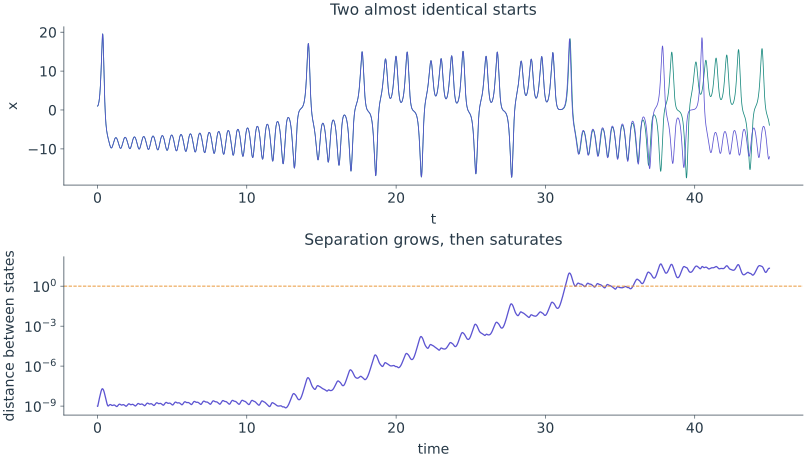
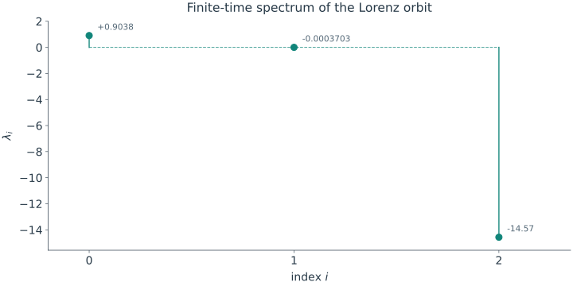

<span class="ts-kicker">Tutorial · Anatomy of a chaotic attractor</span>

# Anatomy of a chaotic attractor

This tutorial simulates the Lorenz system, plots its orbit, and compares several
pieces of numerical evidence for chaos: finite trajectory separation, the
Lyapunov spectrum and two dimension estimates. It also checks phase-volume
contraction against an exact identity. These finite-time calculations are
cross-checks, not a mathematical proof or a guaranteed dimension measurement.

The example is the **Lorenz system** (Lorenz, 1963), a three-variable model of
thermal convection:

$$
\dot{x} = \sigma(y - x), \qquad
\dot{y} = x(\rho - z) - y, \qquad
\dot{z} = xy - \beta z,
$$

at the classic parameters $\sigma = 10$, $\rho = 28$, $\beta = 8/3$ where its
solutions are chaotic.

## 1. Instantiate the system

Lorenz is in the [catalogue](../systems/index.md), so there is nothing to write
— just create it. (The [next tutorial](bifurcations.md) and the
[definition guide](../start/defining-systems.md) show how to write your own; the
contract is one symbolic `_equations` method.)

```python
import numpy as np
import tsdynamics as ts

lor = ts.systems.Lorenz()
lor.params       # ParamSet({sigma=10.0, rho=28.0, beta=2.6666666666666665})
lor.variables    # ('x', 'y', 'z')  — named components
```

!!! note "Pin the initial condition"
    The Lorenz class ships with `default_ic = None`, which means a bare
    `run()` picks a *random* start. Every snippet below passes an
    explicit `ic=[1.0, 1.0, 1.0]` so the experiment has a stated starting point. Make
    this a habit whenever you quote a value: pin the IC (and, for anything
    stochastic, the `seed=`).

## 2. Integrate — and draw the butterfly

`run` marches the flow and hands back a [`Trajectory`](../analysis/index.md):
a `(T, dim)` array of states with named components and its provenance in
`traj.meta`.

<div class="ts-ref" markdown>

<div class="ts-item" markdown>
```python
traj = lor.run(final_time=100.0, dt=0.01, ic=[1.0, 1.0, 1.0])

traj.y.shape     # (10001, 3)
traj["z"]        # the z-channel by name
traj.meta["method"]   # the solver that ran — 'rk45'
```

A three-component trajectory draws as a 3-D phase portrait straight from the
[`ts.plot`](../visualization/index.md) chooses the view from the
component count. We hide the axes and set a camera angle for a clean "attractor
floating in space":

```python
(ts.plot(traj)                          # 3 components → a 3-D phase portrait
     .style(axes=False)
     .camera(elev=22, azim=-60)
     .save("lorenz.png"))
```
</div>

<figure class="ts-fig" markdown>
{ loading=lazy }
<figcaption><span class="lbl">FIG 1</span> · the Lorenz butterfly — a 3-D phase portrait of a finite trajectory, axes hidden with <code>style(axes=False)</code> and framed with <code>camera(elev=22, azim=-60)</code>. The two-lobed geometry motivates the numerical checks below; a picture alone does not establish chaos.</figcaption>
</figure>

</div>

The picture is suggestive — the trajectory fills a bounded region without ever
closing into a cycle — but "looks complicated" is not chaos. For that we need
the defining property.

## 3. The defining property: sensitive dependence

One signature of chaos is **sensitive dependence on initial conditions**:
nearby states can separate exponentially over a useful range of scales, so
initial uncertainty limits prediction *even when the equations are deterministic*.
On a bounded attractor, finite separations eventually saturate at the size of
the attractor. We can watch this happen
directly. Integrate from two initial conditions one part in a billion apart and
track the distance between them:

```python
a = ts.systems.Lorenz().run(final_time=45.0, dt=0.01, ic=[1.0, 1.0, 1.0])
b = ts.systems.Lorenz().run(final_time=45.0, dt=0.01, ic=[1.0 + 1e-9, 1.0, 1.0])

sep = np.linalg.norm(a.y - b.y, axis=1)      # distance vs time
a.t[np.argmax(sep > 1.0)]      # ≈ 34.4  — time for the gap to reach order 1
sep[-1]                        # ≈ 20    — fully decorrelated by t = 45
```

<figure class="tsd-showcase" markdown="1">

{ loading=lazy }

<figcaption><span class="tsd-caption-label">Read both views</span><br>The component signals hide the initial difference. The logarithmic distance makes its growth visible, then shows why a long-time straight-line fit would be misleading.</figcaption>
</figure>

The two trajectories are visually identical for a while, then the gap explodes:
a $10^{-9}$ initial difference grows to order 1 by $t \approx 34$ and to the
scale of the attractor itself shortly after. That is the *predictability
horizon* — push the starting uncertainty down by another factor of ten and you
buy only a *constant* extra amount of forecast time, because the growth is
exponential, not linear. The numerical horizon also depends on the initial direction, transient growth
and the accuracy required of the forecast.

## 4. Quantify it: the Lyapunov spectrum

Sensitive dependence has a *rate*, and that rate is the top **Lyapunov
exponent**. The full spectrum $\lambda_1 \ge \lambda_2 \ge \lambda_3$ gives one
number per direction in state space: how fast an infinitesimal ball of nearby
states stretches along each axis as it is carried by the flow.
[`lyapunov_spectrum`](../analysis/lyapunov.md) integrates the *variational*
dynamics alongside the state and reads the exponents off a periodically
reorthonormalised frame (Benettin et al., 1980):

```python
spec = ts.analysis.lyapunov_spectrum(ts.systems.Lorenz(ic=[1.0, 1.0, 1.0]),
                            final_time=300.0, dt=0.05, transient=40.0)

np.asarray(spec)     # ≈ [ 0.908, -0.001, -14.57]
print(spec)
# LyapunovSpectrum  λ = [0.9081, -0.001005, -14.57]   chaotic · D_KY = 2.062   (Lorenz)
```

<figure class="tsd-showcase" markdown="1">

{ loading=lazy }

<figcaption>The result is plottable directly with <code>ts.plot(spec)</code>. These are finite-time estimates: increase the averaging window and check whether the rates settle before quoting them.</figcaption>
</figure>

Read the signs — they are a fingerprint of the dynamics:

- $\lambda_1 \approx +0.90 > 0$: **one expanding direction.** A persistent positive
  rate on this bounded orbit supports sensitive dependence. Its value is the exponential
  rate we just watched in the separation experiment: $e^{0.9\,t}$ grows a
  $10^{-9}$ gap to order 1 in roughly $\ln(10^9)/0.9 \approx 23$ time units, the
  right order of magnitude for the $t \approx 34$ we measured (the early growth
  is slower than the asymptotic rate).
- $\lambda_2 \approx 0$: the **neutral direction *along* the flow**. For a bounded
  non-equilibrium orbit of an autonomous flow, a time shift follows the same
  motion. Its asymptotic exponent is zero under the usual regularity conditions;
  a finite-time estimate can lie on either side of zero. Equilibria and explicitly
  forced systems need separate reasoning.
- $\lambda_3 \approx -14.6 < 0$: a **strongly contracting direction.** This is
  what pins the motion onto a thin attractor instead of filling space.

That the exponents are *positive, zero, negative* — in that order — is the
signature of a chaotic dissipative flow. There is even an exact check: the sum
of the exponents equals the average divergence of the vector field, which for
Lorenz is the constant $-(\sigma + 1 + \beta)$:

```python
float(np.sum(np.asarray(spec)))     # ≈ -13.667
-(10.0 + 1.0 + 8/3)                 #    -13.667  — phase-space volume shrinks at this rate
```

This is an independent consistency check: phase-space volumes contract by
$e^{-13.667}$ per unit time. Volume contraction establishes dissipative behaviour;
it does not by itself establish chaos or identify the attracting set.

!!! tip "Only need the top exponent?"
    Ask for one: `ts.analysis.lyapunov_spectrum(lor, k=1, ic=[1.0, 1.0, 1.0])`.
    When the right-hand side is non-smooth and has no analytic Jacobian, the
    same call falls back to the classic
    [two-trajectory method](../analysis/lyapunov.md), which uses nothing but the
    stepping protocol.

## 5. The attractor's dimension — two ways

A strange attractor can have non-integer geometric dimension. The **Kaplan–Yorke
dimension** is a related estimate derived from the stretching rates, rather
than a direct measurement of that geometry. It interpolates between the
expanding and contracting directions —
$D_{KY} = j + (\lambda_1 + \dots + \lambda_j)/|\lambda_{j+1}|$ at the point
where the cumulative exponent sum crosses zero (Kaplan & Yorke, 1979):

```python
spec.kaplan_yorke        # ≈ 2.062
ts.analysis.kaplan_yorke_dimension([0.908, -0.001, -14.57])   # ≈ 2.062  — the same, from the bare numbers
```

$D_{KY} \approx 2.06$ is the dimension suggested by this spectrum. Relating a
Lyapunov dimension to a geometric dimension requires additional assumptions;
the different definitions need not agree for a general system.

Now compare it with a geometric estimate, without any Jacobian, by measuring the geometry
of the point cloud directly. The [correlation
dimension](../analysis/dimensions.md) (Grassberger & Procaccia, 1983) counts how
the fraction of close point-pairs scales with radius:

```python
cloud = ts.systems.Lorenz().run(final_time=200.0, dt=0.02, ic=[1.0, 1.0, 1.0]).y[2000:]
ts.analysis.correlation_dimension(cloud, theiler=200)     # ≈ 2.06
```

The two routes ask related questions using different data: tangent-space
stretching versus pairwise distances. Agreement is a useful cross-check, not a
validation certificate. Inspect the correlation-sum scaling region and vary
record length, radius range and Theiler window. Here `theiler=200` excludes
nearby-in-time pairs that would bias a densely sampled flow; its appropriate
size depends on the correlation time and sampling interval.

## 6. Watch it draw itself

Finally, for a talk or a paper's supplementary material, the same spec animates:
a reveal-comet traces the already computed trajectory, a fading tail behind
the moving head.

<div class="ts-ref" markdown>

<div class="ts-item" markdown>
```python
(ts.plot(traj, animate=True)
     .animate(n_frames=240, fps=30)
     .trail(("time", 6.0), fade=True)     # 6-time-unit fading tail
     .head(color="#F5A623")               # amber "current state" dot
     .style(axes=False)
     .camera(elev=22, azim=-60)
     .save("lorenz.gif"))
```

The `.mp4` / `.gif` extensions render through matplotlib; a `.html` extension
instead exports a real-time interactive Plotly comet you can rotate while it
plays. See the [visualization section](../visualization/index.md) for the full
animation model.
</div>

<figure class="ts-fig" markdown>
{ loading=lazy }
<figcaption><span class="lbl">Animation recipe</span> · a fading trail follows the current-state marker. With 240 frames at 30 fps the exported movie lasts eight seconds. See the animation guide for controllable video previews, camera motion and longer presentations.</figcaption>
</figure>

</div>

## What you built

From a catalogue system and half a dozen calls you gathered numerical evidence
for chaos: the attractor drawn, sensitive dependence witnessed, the
Lyapunov spectrum computed with its signs read, the phase-volume contraction
checked against theory, and two related dimension estimates compared.
Every result carries its settings in `traj.meta` / the result's `.meta`,
so the input choices can be retained with the results.

The [next tutorial](bifurcations.md) studies how the long-term motion changes
as a parameter varies.

## See also

- [Lyapunov spectra](../analysis/lyapunov.md) — the full spectrum API for flows, maps and delay systems, the Jacobian-free fallback, and the Kaplan–Yorke dimension
- [Fractal dimensions](../analysis/dimensions.md) — the correlation dimension and the rest of the fractal-geometry toolkit
- [The road to chaos](bifurcations.md) — how a fixed point period-doubles into an attractor like this one
- [Reconstruction from one signal](reconstruction.md) — recover all of the above from a single measured channel
- [Chaos indicators](../analysis/chaos.md) — alignment, scalar-series and regional-growth indicators with different assumptions

## References

- Lorenz, E. N. (1963). Deterministic nonperiodic flow. *J. Atmos. Sci.* **20**, 130–141.
- Benettin, G., Galgani, L., Giorgilli, A. & Strelcyn, J.-M. (1980). Lyapunov characteristic exponents for smooth dynamical systems … *Meccanica* **15**, 9 & 21.
- Kaplan, J. L. & Yorke, J. A. (1979). Chaotic behavior of multidimensional difference equations. *LNM* **730**, 204.
- Grassberger, P. & Procaccia, I. (1983). Measuring the strangeness of strange attractors. *Physica D* **9**, 189–208.
