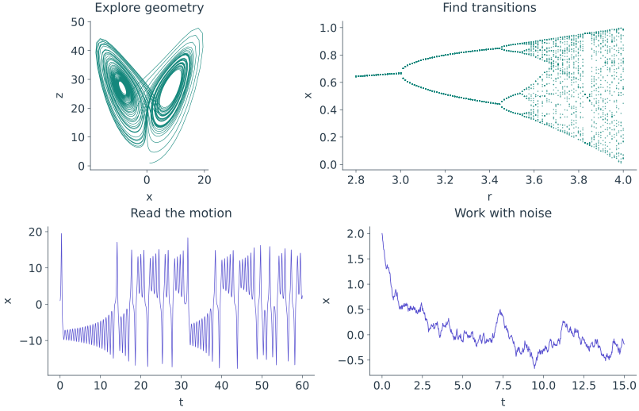
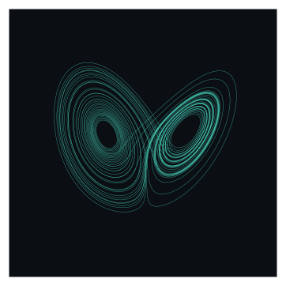
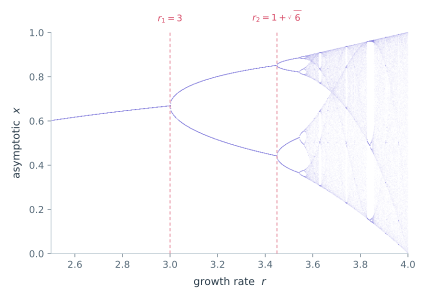
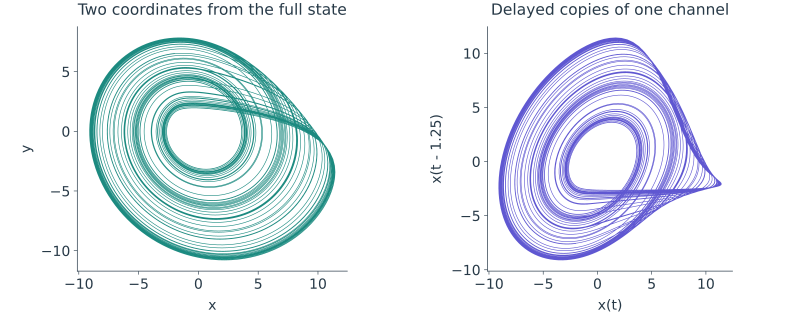
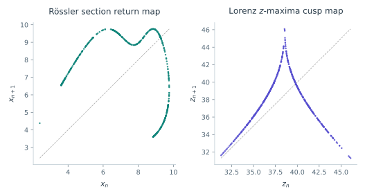
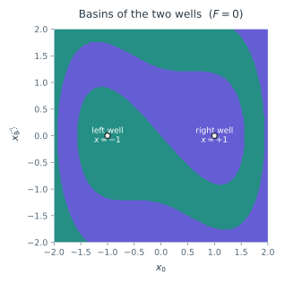
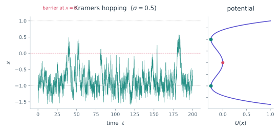

Guided experiments

# Tutorials {#learn-by-doing}

Start with a question. Run the model, make a figure, then use the numerical
tools to investigate what you see. Each tutorial connects the equations to a
complete experiment, with code you can run in order.

[Start with seven tasks](seven-tasks.md){ .md-button .md-button--primary }
[Explore the plotting guide](../visualization/index.md){ .md-button }

<figure class="tsd-showcase" markdown="1">

{ loading=lazy }

<figcaption>Example workflows Geometry, parameter changes, time evolution and noise. These panels are assembled with the same <code>|</code> and <code>/</code> operators used in the visualization guide.</figcaption>
</figure>

## Your first complete workflow

The [seven-task introduction](seven-tasks.md) takes you from a first trajectory
to chaos indicators, bifurcation diagrams, equilibria, basins and an animated
phase portrait. Finish by defining a system of your own. Use it as a tour of the
library, then choose a deeper experiment below.

## Choose an experiment

<article class="tsd-feature-card" markdown="1">

[{ loading=lazy }](chaotic-attractor.md)

Chaotic flows

### [Anatomy of a chaotic attractor](chaotic-attractor.md)

Watch nearby states separate. Read a Lyapunov spectrum, inspect the dimension
estimate, and turn the trajectory into a movie.

</article>

<article class="tsd-feature-card" markdown="1">

[{ loading=lazy }](bifurcations.md)

Parameter sweeps

### [The road to chaos](bifurcations.md)

Find period doubling and periodic windows. Begin with a map, then build a
Rössler sweep through a Poincaré section.

</article>

<article class="tsd-feature-card" markdown="1">

[{ loading=lazy }](reconstruction.md)

Working from data

### [Reconstruction from one signal](reconstruction.md)

Choose a delay and embedding dimension from diagnostic curves. Rebuild a
state-space picture and inspect data-driven estimates.

</article>

<article class="tsd-feature-card" markdown="1">

[{ loading=lazy }](poincare-return-maps.md)

Reduced dynamics

### [Poincaré sections and return maps](poincare-return-maps.md)

Turn a flow into a map of crossings. Reveal structure hidden inside a
three-dimensional orbit.

</article>

<article class="tsd-feature-card" markdown="1">

[{ loading=lazy }](basins-multistability.md)

Global structure

### [Basins and multistability](basins-multistability.md)

Find competing attractors, map their basins, then tilt the system and watch
one possible outcome disappear.

</article>

<article class="tsd-feature-card" markdown="1">

[{ loading=lazy }](noise-driven.md)

Stochastic models

### [Noise-driven dynamics](noise-driven.md)

Compare sample paths with ensemble statistics and analytic laws. Distinguish
barrier recrossings from completed transitions between wells.

</article>

## Make the experiment your own

Run the blocks in order with the stated initial conditions and seeds. Inspect
the figures before interpreting a number, then change a parameter, observation
window or plotting style and repeat. Numerical values are illustrative estimates;
chaotic trajectories and fitted quantities can vary with solver settings,
software versions and the length of the record.

Keep the [analysis reference](../analysis/index.md) nearby for assumptions and
options. Use [plot composition](../visualization/composition.md) to assemble a
figure, [styling](../visualization/styling.md) to give it a consistent look, and
[animation](../visualization/animation.md) to explain how the motion unfolds.
