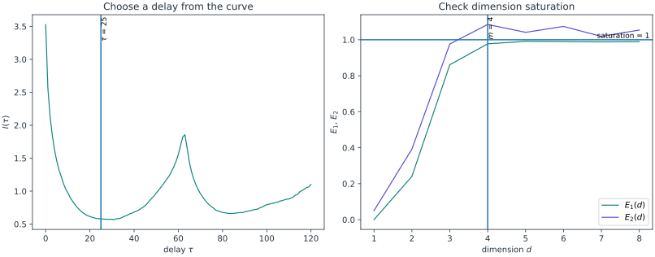

<span class="ts-kicker">Tutorial · Reconstruction from one signal</span>

# Reconstruction from one signal

The first two tutorials had the luxury every textbook has and no experiment ever
does: the equations. Real data arrives the other way round. You have a single
recorded channel — a voltage, a concentration, a light curve — sampled over time,
and *nothing else*. No state vector, no model, no idea whether the wiggle in
front of you is a deterministic system worth analysing or just filtered noise.

This tutorial walks the whole inference the other direction: from one scalar
$x(t)$ back to the geometry and invariants of the system that produced it. We
will **reconstruct** the attractor from the single channel, choose the two
reconstruction parameters with principled heuristics, and measure the
attractor's fractal dimension and its largest Lyapunov exponent *from the
recording* — then compare these finite-data estimates with the full-state model.

We generate the signal from the Rössler flow and analyse one observed channel,
keeping its sampling times. The full trajectory is set aside for a comparison
at the end; the reconstruction itself uses no equations.

```python
import tsdynamics as ts

# generate a trajectory, then keep ONLY the x channel — pretend this is all you recorded
full = ts.systems.Rossler().run(final_time=400.0, dt=0.05, ic=[1.0, 0.0, 0.0])
signal = full.after(50.0)["x",]  # a one-column Trajectory, retaining its times
x = signal.y[:, 0]              # scalar samples; transient dropped
x.shape                     # (7001,)
```

All the estimates below use `x`; `signal` retains the same channel's time axis
for plotting. A single name, `trajectory["x"]`, returns an array; the one-name tuple
`trajectory["x",]` keeps a `Trajectory` and its time axis.

## 1. The theorem that makes it possible

Delay reconstruction stacks copies of one signal into a vector,

$$
\mathbf{y}_i = \big(x_i,\; x_{i+\tau},\; x_{i+2\tau},\; \dots,\; x_{i+(m-1)\tau}\big).
$$

The classical [Takens theorem](https://doi.org/10.1007/BFb0091924) concerns
generic smooth dynamics and observables on a compact $d$-dimensional manifold:
under its assumptions, $2d+1$ delay coordinates give an embedding. It does not
certify a finite noisy recording or promise that an arbitrary three-coordinate
projection is faithful.

In practice we choose a **delay** $\tau$ and an **embedding dimension** $m$ using
diagnostic curves, then test sensitivity to those choices. The
[delay-embedding tools](../analysis/embedding.md) provide the heuristics below.

## 2. Choose the delay

The delay trades two failures against each other. Too small, and $x_i$ and
$x_{i+\tau}$ are nearly identical — the reconstruction collapses onto the
diagonal. Too large, and on a chaotic signal they become causally unrelated — the
geometry folds noise into itself. A common heuristic is the **first local
minimum of the time-delayed mutual information** (Fraser & Swinney, 1986).
It seeks delayed coordinates with reduced redundancy; it does not guarantee
an optimal reconstruction.

```python
tau = ts.analysis.optimal_delay(x, method="mi", max_delay=120)   # 25 samples

mi = ts.analysis.mutual_information(x, max_delay=120)
mi.optimal_lag          # 25   — the same lag, read off the I(tau) curve
# mi.plot()             # inspect the curve, with the chosen tau marked
```

`optimal_delay` returns a count that *is* the integer $\tau = 25$ — it prints,
formats and indexes as that integer — so it drops straight into `embed`. The linear alternative — the autocorrelation $1/e$
rule, `method="acf"` — gives $\tau \approx 22$ here, close to the
mutual-information choice; when they disagree, prefer the mutual-information lag,
which sees nonlinear dependence the autocorrelation misses.

## 3. Choose the dimension

The dimension must be large enough to **unfold** the attractor — to remove the
false crossings a too-flat projection creates where two distant states happen to
overlap. **Cao's method** (Cao, 1997) and **Kennel's false nearest neighbours**
(Kennel et al., 1992) inspect neighbour relationships to suggest a candidate
$m$, unified behind `embedding_dimension`:

```python
m_fnn = ts.analysis.embedding_dimension(x, method="fnn", delay=tau, max_dim=8)
int(m_fnn)              # 3   — the threshold-based candidate for this record
m_fnn.saturated        # inspect whether the requested threshold was reached

m_cao = ts.analysis.embedding_dimension(x, method="cao", delay=tau, max_dim=8)
int(m_cao)             # 4   — Cao's conservative saturation threshold
# m_cao.plot()         # the E1/E2 saturation curves, with the chosen m marked
```

The two estimators use different criteria and need not agree. Inspect their
curves and whether the stopping criterion was reached; a selected candidate is
not a theorem about the smallest possible embedding. Here we use $m=3$ as a
practical reconstruction and compare it with nearby choices.

<figure class="tsd-showcase" markdown="1">

{ loading=lazy }

<figcaption><span class="tsd-caption-label">Keep the evidence beside the choice</span><br>Use <code>ts.plot(mi)</code> and <code>ts.plot(m_cao)</code> to inspect the curves behind the estimates. Repeat with longer records and nearby delays before settling on a reconstruction.</figcaption>
</figure>

## 4. Reconstruct — one channel becomes an attractor

With both parameters chosen, `embed` builds the matrix of delay vectors:

<div class="ts-ref" markdown>

<div class="ts-item" markdown>
```python
emb = ts.analysis.embed(x, dimension=3, delay=tau)
emb.shape               # (6951, 3) for tau=25 — one reconstructed state per row
```

The returned `Embedding` behaves as that bare array, so it drops straight into
any point-set analysis. The two leading columns $(x_i,\,x_{i+\tau})$ are the
reconstructed plane — plot them and the folded Rössler loop reappears, rebuilt
from the single channel. Because a `Trajectory` can build the same delay view
directly, you can eyeball the reconstruction with the plotting front door:

```python
# skip-doctest — .save() writes a file; needs the optional tsdynamics[viz] backend
# the x(t) vs x(t - tau) delay portrait, straight from the series.
# `delay=` is in SAMPLES (what optimal_delay returned); `delay_time=` is the
# same lag in time units — here delay_time = tau * 0.05 would be equivalent.
ts.plot(signal, "delay_embedding", delay=tau).save("delay.png")
```
</div>

<figure class="ts-fig" markdown>
{ loading=lazy }
<figcaption><span class="lbl">FIG 1</span> · the Rössler record in two coordinate systems. The delayed view uses one channel; the shapes need not look identical. A lag of 25 samples at dt=0.05 corresponds to 1.25 time units.</figcaption>
</figure>

</div>

## 5. Measure the attractor — from the reconstruction

We can now apply point-cloud and time-series estimators to the reconstruction.
Their finite-data accuracy still depends on sampling, reconstruction quality,
noise, neighbour selection and the fitted scale range.

**Fractal dimension.** The [correlation dimension](../analysis/dimensions.md)
(Grassberger & Procaccia, 1983) reads off the point cloud directly. On a
reconstructed *flow* you must set a Theiler window, because temporally adjacent
samples sit spuriously close and bias the estimate downward. A window of one
delay is an initial choice here; check its sensitivity rather than treating it
as a universally sufficient exclusion:

```python
ts.analysis.correlation_dimension(emb, theiler=tau)     # a finite-record estimate
```

**Largest Lyapunov exponent.** [`lyapunov_from_data`](../analysis/lyapunov.md)
estimates the top exponent from how fast embedded neighbours diverge (Kantz,
1994). Pass the sampling interval `dt=` so the rate comes out per unit time, and
— crucially — **inspect the stretching curve before quoting a number**:

```python
res = ts.analysis.lyapunov_from_data(x, dimension=3, delay=tau, dt=0.05, k_max=80)
res.times, res.divergence      # the S(k) curve — plot it, find the linear stretch
```

Inspect $S(k)$ for a credible approximately linear interval before saturation.
The fitted slope depends on the interval. The following is one candidate window
for this example (indices 6–26, or times 0.3–1.3), which you should compare with
nearby windows:

```python
res = ts.analysis.lyapunov_from_data(x, dimension=3, delay=tau, dt=0.05, k_max=80, fit=(6, 26))
float(res)             # approximately 0.06 per unit time in this finite record
```

!!! warning "Never quote the automatic fit blind"
    A divergence curve can have several slopes before it saturates, so the
    automatic interval can give a biased estimate. The result is only as good as the scaling region you
    choose — always look at `res.times` vs `res.divergence` and pass an explicit
    `fit=(lo, hi)` before quoting a publishable value. This is *the* place
    from-data exponents go wrong.

**How did we do?** We can cheat now and check against the model we threw away:

```python
# a second estimate, from the full state and the equations
ts.analysis.correlation_dimension(full.y[1000:], theiler=tau)
ts.analysis.lyapunov_spectrum(ts.systems.Rossler(), k=1, ic=[1.0, 0.0, 0.0])  # ≈ 0.07
```

The full-state and reconstructed dimension estimates are close for this record,
but both can share finite-length and scale-selection bias. Their agreement does
not establish the asymptotic dimension. Likewise, compare the data-driven slope
with longer variational calculations and inspect fit sensitivity before claiming
an uncertainty interval.

## What you built

Starting from a single scalar channel with the model discarded, you rebuilt the
state-space view by delay embedding, chose candidate $\tau$ and $m$ from mutual
information and false-nearest-neighbours, and inspected dimension and separation
rate estimates from the recording. The full-state comparison is a useful
diagnostic; convergence, noise and scaling checks remain part of the experiment.

## See also

- [Delay embeddings](../analysis/embedding.md) — the full `embed` / `optimal_delay` / `embedding_dimension` API and multivariate embedding
- [Fractal dimensions](../analysis/dimensions.md) — correlation and the rest of the fractal-geometry estimators (and the Theiler window)
- [Lyapunov spectra](../analysis/lyapunov.md) — `lyapunov_from_data`, the Kantz / Rosenstein estimators, and reading the stretching curve
- [Recurrence & RQA](../analysis/recurrence.md) — another quantifier built straight on the reconstruction
- [Anatomy of a chaotic attractor](chaotic-attractor.md) — the same invariants, computed from the equations instead

## References

- Takens, F. (1981). Detecting strange attractors in turbulence. *LNM* **898**, 366.
- Fraser, A. M. & Swinney, H. L. (1986). Independent coordinates for strange attractors from mutual information. *Phys. Rev. A* **33**, 1134.
- Cao, L. (1997). Practical method for determining the minimum embedding dimension of a scalar time series. *Physica D* **110**, 43.
- Kennel, M. B., Brown, R. & Abarbanel, H. D. I. (1992). Determining embedding dimension for phase-space reconstruction … *Phys. Rev. A* **45**, 3403.
- Grassberger, P. & Procaccia, I. (1983). Measuring the strangeness of strange attractors. *Physica D* **9**, 189.
- Kantz, H. (1994). A robust method to estimate the maximal Lyapunov exponent of a time series. *Phys. Lett. A* **185**, 77.
