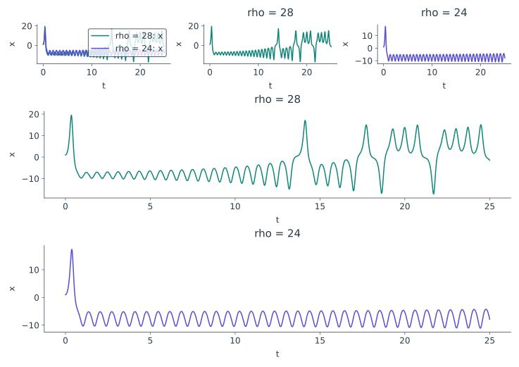
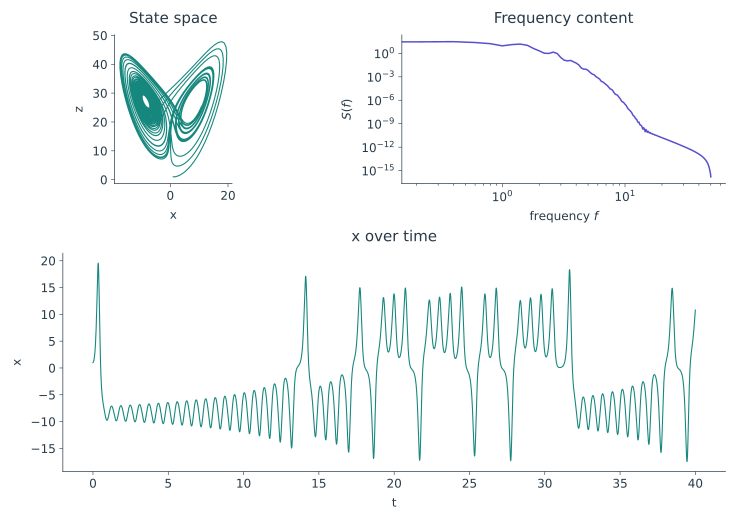

<span class="ts-kicker">Visualization · Composition</span>

# Composing figures {#one-plot-becomes-a-figure}

<div class="tsd-page-intro" markdown="1">

Make each view once. Add compatible views on one set of axes, put different
questions in neighbouring panels, and use parentheses when one panel should
span a whole row. A composed figure is still a `Plot`.

</div>

## Three operators, three arrangements

| Expression | Picture | Use it when |
|---|---|---|
| `a + b` | One panel, shared axes | Both views mean the same coordinates and units |
| `a \| b` | Two panels, side by side | You want a direct comparison |
| `a / b` | Two panels, one above the other | A common horizontal axis helps you read them |

Here are two runs of the same model at different parameter values. We keep the
same initial condition and sampling grid so the comparison is explicit.

<!-- tsd-example: compose-operators -->
```python
import tsdynamics as ts

model = ts.systems.Lorenz(ic=[1, 1, 1])
first = model.run(final_time=25, dt=0.02)
second = model.with_params(rho=24).run(final_time=25, dt=0.02)
a = ts.plot(first, "time_series", components="x", title="rho = 28", color="#11857A")
b = ts.plot(second, "time_series", components="x", title="rho = 24", color="#574FCF")

overlay = a + b
beside = a | b
above = a / b
figure = (overlay | beside) / above
figure.theme("publication", foreground="#273947").font(family="sans-serif", size=12).size(10, 7)
```

<figure class="tsd-showcase" markdown="1">
{ loading=lazy }
<figcaption>Upper left: <code>a + b</code>. Upper right:
<code>a | b</code>. Below: <code>a / b</code>. The combined showcase itself uses
the same operators; each panel keeps the original data.</figcaption>
</figure>

The named spellings are equivalent: `ts.plot(a, b)` overlays,
`ts.plot(a, b, layout="row")` makes a row, and
`ts.plot(a, b, layout="stack")` makes a stack. Operators produce a new outer
plot; fluent tweaks mutate the plot they are called on. Composite panels retain
the original child objects, so a later change to `a` also changes its uses in a
composite. Use `a.copy()` when variants need independent styling or different
windows; the copy carries independent layers and panels without a rendered cache.

```python
reference_view = ts.plot(first, "time_series", components="x", title="Full record")
detail_view = reference_view.copy().limits(x=(10, 15)).relabel(title="Detail")
comparison = reference_view | detail_view
```

For a complete figure comparing an overlay with matching separate panels, see
[Compare runs](recipes.md#compare-runs). The recipes also cover arrays,
ensembles, analysis results and scalar fields.

## Give each question its own axes

A state-space portrait and a power spectrum describe different quantities.
They belong in separate panels. In this layout the time series spans the width
below them:

<!-- tsd-example: compose-nested -->
```python
import tsdynamics as ts

trajectory = ts.systems.Lorenz(ic=[1, 1, 1]).run(final_time=40, dt=0.01)
portrait = ts.plot(trajectory, components=["x", "z"], title="State space", color="#11857A")
spectrum = ts.plot(trajectory, "psd", components="x", title="Frequency content", color="#574FCF")
trace = ts.plot(trajectory, "time_series", components="x", title="x over time", color="#11857A")

figure = (portrait | spectrum) / trace
figure.theme("publication", foreground="#273947").font(family="sans-serif", size=12).size(10, 7)
```

<figure class="tsd-showcase" markdown="1">
{ loading=lazy }
<figcaption>Read the parentheses as blocks: first make a row, then put that row
above the timeline. The lower panel spans the entire figure.</figcaption>
</figure>

Python gives `/` higher precedence than `|`. Write the parentheses explicitly:
`(a | b) / c` is a row above `c`; `a | (b / c)` is `a` beside a column.
A child with the same arrangement is absorbed: `(a | b) | c` is one row of three.
A child with a different arrangement remains a nested block.

## A regular grid, when you need one

```python
x_view = ts.plot(trajectory, "time_series", components="x", title="x")
y_view = ts.plot(trajectory, "time_series", components="y", title="y")
z_view = ts.plot(trajectory, "time_series", components="z", title="z")
figure = ts.plot(x_view, y_view, z_view, layout="grid", cols=2)
figure.theme("publication").font(family="sans-serif").size(9, 6)
```

`rows=` or `cols=` sets one grid dimension; set both to choose an exact capacity.
A stack of time series with the same time axis shares its horizontal axis by
default. For other compatible panels, request `share_x=True` or `share_y=True`
at composition time. Share axes only when their coordinates and units match.
Use `share_color=True` for comparable scalar fields that need one colour scale.

### Sharing an axis is a scientific choice

| Comparison | Sensible sharing |
|---|---|
| Several channels measured at the same times | `share_x=True`; keep different units on separate vertical axes |
| Same observable in several runs | `share_x=True, share_y=True` when their time origins match |
| Phase portrait beside a spectrum | Independent axes; these coordinates mean different things |
| Same scalar field at several times | Common `clim` and `share_color=True` |

Set a common color range on the field panels **before** composing them. This
makes the intended comparison explicit when `share_color=True` reconciles their
colorbars. The [spatial recipe](recipes.md#spatial-fields) demonstrates one shared
bar. It should describe one quantity, rather than combine unrelated variables
because both happen to be represented by colors.

## Work on the whole figure, then a panel

```python
figure = (portrait | spectrum) / trace
figure.theme("publication").font(family="sans-serif").size(10, 7)
figure.relabel(title="Lorenz: geometry, frequency and time")
figure[0][0].recolor("#11857A")
figure[0][1].recolor("#574FCF")
figure[1].relabel(x="Time", y="x")
```

The outer figure has two children: an upper row and a lower trace.
`figure[0][1]` therefore selects the spectrum inside the upper row.
Axis tweaks such as `.limits(...)` and `.gridlines(...)` on a composite recurse
through its panels. The outer title, size and background belong to the figure.
See [styling](styling.md) for theme inheritance and panel overrides.

For example, preserve the wide context while focusing only the spectrum:

```python
figure = (portrait.copy() | spectrum.copy()) / trace.copy()
figure.theme("publication").font(family="sans-serif").size(10, 7)
figure[0][0].style(color="#11857A", linewidth=0.8)
figure[0][1].rescale(x="linear").limits(x=(0, 3))
figure[1].gridlines(axis="y", alpha=0.2)
```

A tweak on the outer figure recurses to its children; a tweak on a selected
panel stays there. Apply an outer theme first, then local overrides. To give a
single panel its own coherent theme, use `figure[0][1].theme("minimal")`.

## Overlay coordinates that mean the same thing

An overlay is checked by its **coordinate frame**, including dimensionality and
axis names. Two `(x, y)` orbits can share axes; an `(x, z)` orbit and a power
spectrum cannot. This also allows compatible layers of different kinds—such as
an orbit and a vector field in the same phase plane—to appear together.

```python
model = ts.systems.VanDerPol()
trajectory = model.run(final_time=30, dt=0.02, ic=[2.5, 0])
figure = ts.plot(model, trajectory, "flow_speed", "nullclines")
```

The equation-based transforms consume the model, while the trajectory adds its
orbit. Fields are drawn behind trajectories and overlays. If the frames do not
match, use `|` or `/` to give each view its own axes.

## Animate the figure you already made

```python
movie = (portrait | trace).animate(duration=6, fps=24)
```

Both panels play on one master timeline. When they come from the same
trajectory, they show the same orbit at the same instant. Different-length
inputs are synchronized by relative progress; that is a comparison of playback,
not proof that their physical times coincide. The [animation guide](animation.md)
builds and exports this linked view.

Matplotlib supports nested figures and composite movies. Plotly supports flat
static composites; nested layouts and animated composites fall back to
Matplotlib with a capability warning. Choose a still or MP4 when preserving a
complex layout matters more than browser interactivity.
