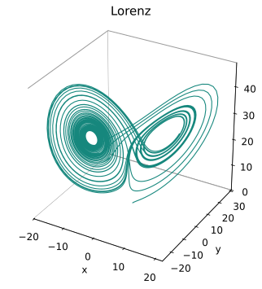

<span class="ts-kicker">Visualization</span>

# A useful picture, in a few lines

<div class="tsd-page-intro" markdown="1">

Start with a trajectory. Give it a view, put related views together, and save the
result. The same `Plot` carries your data, layout and styling from a notebook
sketch to a figure or movie.

</div>

Install the drawing backend once: `pip install "tsdynamics[viz]"`.

<div class="tsd-example-pair" markdown="1">
<div markdown="1">

## Make your first plot

<!-- tsd-example: first-plot -->
```python
import tsdynamics as ts

model = ts.systems.Lorenz(ic=[1, 1, 1])
trajectory = model.run(final_time=40, dt=0.01)

figure = ts.plot(trajectory, color="#11857A")
figure.theme("publication").font(family="sans-serif")
figure.size(6.4, 4.6)
```

In a notebook, put `figure` on the last line to display it. In a script, call
`figure.show()`. Save a still with `figure.save("lorenz.svg")` or
`figure.save("lorenz.png")`.

</div>
<figure markdown="1">
{ loading=lazy }
<figcaption>The code produces this figure. A three-component trajectory gets a
3-D phase portrait by default; the publication theme supplies a clean white
canvas.</figcaption>
</figure>
</div>

## Ask for the view you need

A quoted name chooses a transform; `components=` chooses the state variables.
You can start with an existing trajectory, a model, an array, or an analysis
result.

```python
portrait = ts.plot(trajectory, components=["x", "z"], title="State space")
trace = ts.plot(trajectory, "time_series", components="x", title="x over time")
spectrum = ts.plot(trajectory, "psd", components="x", title="Frequency content")
```

`ts.plot(model, final_time=40, dt=0.01)` can run the model and plot it in one call.
Keeping the trajectory is useful when several views should show the same data.
The [gallery](gallery.md) shows every registered transform with real output and
its code.

## Put the views together

Use `+` to put compatible data on the **same axes**, `|` for views **beside one
another**, and `/` for views **above and below**. Parentheses describe a nested
layout.

```python
figure = (portrait | spectrum) / trace
figure.theme("publication").font(family="sans-serif").size(10, 7)
```

<figure class="tsd-showcase" markdown="1">
{ loading=lazy }
<figcaption markdown="1">Two complementary views above one shared timeline. The
[composition guide](composition.md) builds this layout step by step and explains
when an overlay is meaningful.</figcaption>
</figure>

<div class="tsd-feature-grid" markdown="1">
<div class="tsd-feature-card" markdown="1">

### Compare and compose

**[Build a figure](composition.md)** with overlays, rows, stacks and nested
layouts. Keep each panel's own axes and units where they matter.

</div>
<div class="tsd-feature-card" markdown="1">

### Give it a consistent look

**[Style the figure](styling.md)** with a theme, a few intentional colours and
readable labels. Fine-tune individual panels when needed.

</div>
<div class="tsd-feature-card" markdown="1">

### Show the motion

**[Make a movie](animation.md)** from the same plot. Reveal an orbit, link it to
a time series, or play a spatial field frame by frame.

</div>
</div>

## Polish once, export when ready

```python
figure.theme("publication").relabel(title="One orbit, three views")
figure[1].relabel(x="Time", y="x")
```

`figure[1]` is the lower time-series panel of this nested figure;
`figure[0][0]` is its upper-left portrait. Tweaks mutate the plot and return it,
so chains read in the order you apply them.

| You need | Use |
|---|---|
| A still for a paper or slide | `.save("figure.svg")`, `.pdf` or `.png` |
| A movie | `.animate(duration=6, fps=24).save("figure.mp4")` with FFmpeg installed |
| An interactive page for a supported single view or flat static layout | `.save("figure.html")` with the `interactive` extra |
| A portable plot description | `.save("figure.json")` |

Matplotlib renders nested layouts and movies. Interactive renderers support a
smaller set of features; a capability warning explains a fallback or unsupported
option. See [backends and export](backends.md) before choosing an interactive
format for a complex figure.

For a complete map of accepted inputs and the extension API, continue to
[transforms and primitives](plotting.md). For colour scales, axes and scientific
presentation, see [figure conventions](conventions.md).
