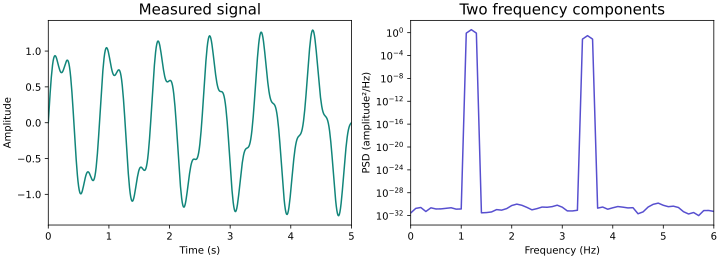
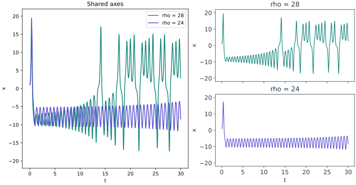
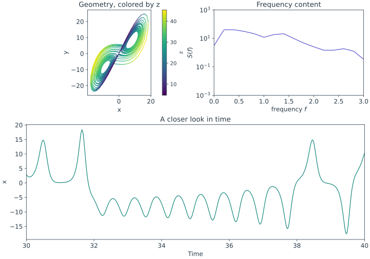
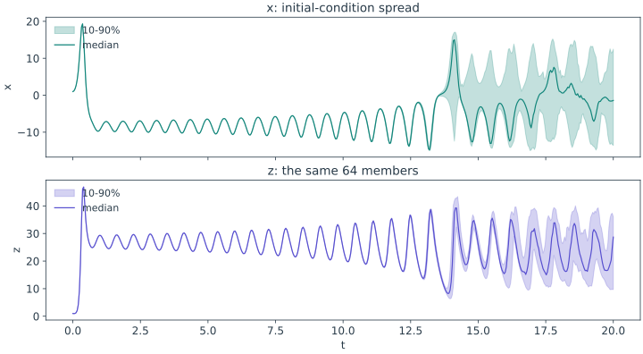
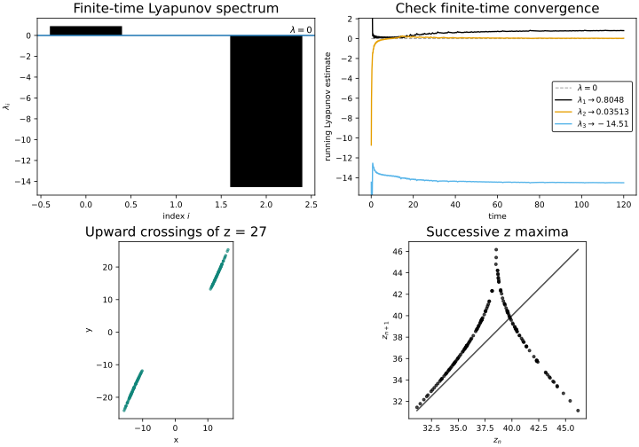
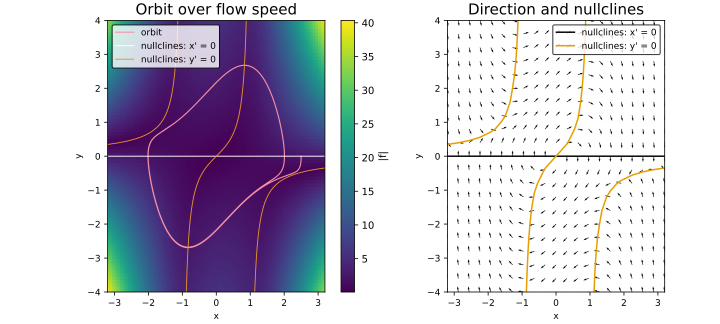
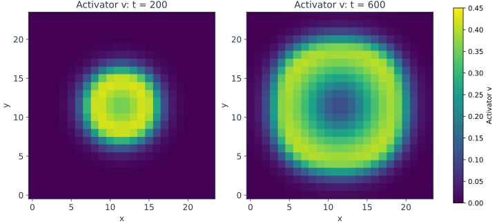

<span class="ts-kicker">Visualization · Recipes</span>

# Scientific figure recipes {#build-the-figure-you-need}

Start with the question, then choose the views that answer it. Each recipe below
is complete: copy the code, change the data or model, then adjust the individual
panels. The displayed SVG is generated by that exact code through the public API.

| I want to… | Start here |
|---|---|
| Plot measured arrays with the correct time and frequency units | [Arrays and timestamps](#arrays-and-timestamps) |
| Compare runs on shared axes or separate panels | [Compare runs](#compare-runs) |
| Put geometry, frequency and time in one figure | [A dashboard with independent panels](#a-dashboard-with-independent-panels) |
| Summarize many trajectories without hiding their spread | [An ensemble fan](#an-ensemble-fan) |
| Show the evidence behind an analysis | [Analysis results in context](#analysis-results-in-context) |
| Read an orbit against its governing vector field | [Equations and trajectories](#equations-and-trajectories) |
| Compare spatial snapshots on one color scale | [Spatial fields](#spatial-fields) |

All examples leave a `figure` ready to display or export:

```python
# skip-doctest: run after any complete recipe below
figure.show()
figure.save("figure.svg")                     # scalable line art
figure.save("figure.png", size=(1600, 1000), dpi=200)
```

`figure.size(width, height)` uses **inches**; `save(..., size=(width, height))`
uses **pixels**. Static nested layouts export through Matplotlib. See
[backends and export](backends.md) for interactive formats and capability limits.

## Arrays and timestamps

A `(samples, components)` array does not carry a clock. Supply `dt=` when the
samples are uniformly spaced, or keep the timestamps in a `Trajectory`. Here the
same measured channel appears as a trace and a power spectral density.

<!-- tsd-recipe: recipe-data -->
```python
import numpy as np
import tsdynamics as ts

dt = 0.01
t = np.arange(2000) * dt
signal = np.sin(2 * np.pi * 1.2 * t) + 0.3 * np.sin(2 * np.pi * 3.5 * t)

trace = ts.plot(signal, dt=dt, title="Measured signal", color="#11857A")
trace.relabel(x="Time (s)", y="Amplitude").limits(x=(0, 5))
power = ts.plot(signal, "psd", dt=dt, nperseg=1000,
                title="Two frequency components", color="#574FCF")
power.relabel(x="Frequency (Hz)", y="PSD (amplitude²/Hz)")
power.rescale(x="linear").limits(x=(0, 6), y=(1e-6, 10))

figure = trace | power
figure.theme("minimal", background="white", foreground="#273947",
             palette=["#11857A", "#574FCF", "#B76D18"],
             font_family="sans-serif", font_size=12, title_size=13.5).size(10, 3.6)
```

<figure class="tsd-showcase" markdown="1">
{ loading=lazy }
<figcaption>The trace shows a five-second window; the PSD uses all twenty
seconds. Its units follow the supplied 0.01-second sampling interval.</figcaption>
</figure>

The linear frequency axis makes peak locations easy to compare; power remains
logarithmic to reveal weaker components. The default Welch estimate uses density
normalization, so its ordinate is amplitude squared per unit frequency. The
1,000-sample segments give a 0.1-Hz frequency grid for this record. The visible
density range excludes the numerical floor; it changes the view, not the data.

For multiple channels, columns are components:

```python
values = np.column_stack([signal, np.cos(2 * np.pi * 1.2 * t)])
record = ts.Trajectory(t=t, y=values)
ts.plot(record, "time_series", components=[0, 1], labels=["sensor"])
ts.plot(record, components=[0, 1])              # one channel against the other
```

Without `dt=` or timestamps, the horizontal axis is sample index, and a spectrum's
frequencies are cycles per sample. Frequency-based analyses require uniform
sampling; a `Trajectory` preserves irregular timestamps for views that support
them, but does not resample them for you.

## Compare runs

Use an overlay when both traces mean the same coordinates and units. Separate
panels make each run easier to inspect. This recipe shows both choices while
keeping the sampling, initial condition and vertical scale fixed.

<!-- tsd-recipe: recipe-compare -->
```python
import tsdynamics as ts

model = ts.systems.Lorenz(ic=[1, 1, 1])
reference = model.run(final_time=30, dt=0.02)
changed = model.with_params(rho=24).run(final_time=30, dt=0.02)

overlay = ts.plot(reference, changed, "time_series", components="x",
                  labels=["rho = 28", "rho = 24"], title="Shared axes")
overlay.palette(["#11857A", "#574FCF"]).limits(y=(-22, 22))
a = ts.plot(reference, "time_series", components="x", title="rho = 28", color="#11857A")
b = ts.plot(changed, "time_series", components="x", title="rho = 24", color="#574FCF")
separate = ts.plot(a, b, layout="stack", share_x=True, share_y=True)
separate.limits(y=(-22, 22))

figure = overlay | separate
figure.theme("minimal", background="white", foreground="#273947",
             palette=["#11857A", "#574FCF", "#B76D18"],
             font_family="sans-serif", font_size=12, title_size=13.5).size(10, 5.2)
```

<figure class="tsd-showcase" markdown="1">
{ loading=lazy }
<figcaption>Overlay for direct comparison; small multiples for legibility.
Matching scales make amplitude differences visible without changing the frame.</figcaption>
</figure>

`a + b`, `a | b`, and `a / b` mean overlay, row and stack. Call-based layouts
also accept `layout="grid", cols=2`. [Composition](composition.md) explains
nested indexing, shared axes and how to reuse views safely.

## A dashboard with independent panels

Make a view for each question, arrange them, then customize the panels that need
different ranges. A scalar color channel can reveal an observable that is absent
from the two displayed coordinates.

<!-- tsd-recipe: recipe-linked-views -->
```python
import tsdynamics as ts

trajectory = ts.systems.Lorenz(ic=[1, 1, 1]).run(final_time=50, dt=0.02).after(10)
phase = ts.plot(trajectory, components=["x", "y"], color_by=lambda tr: tr["z"],
                title="Geometry, colored by z")
phase.colorize(cmap="viridis", colorbar={"label": "z"})
power = ts.plot(trajectory, "psd", components="x", color="#574FCF",
                title="Frequency content")
trace = ts.plot(trajectory, "time_series", components="x", color="#11857A",
                title="A closer look in time")

figure = (phase | power) / trace
figure.theme("minimal", background="white", foreground="#273947",
             palette=["#11857A", "#574FCF", "#B76D18"],
             font_family="sans-serif", font_size=12, title_size=13.5).size(10, 7)
figure[0][1].rescale(x="linear").limits(x=(0, 3), y=(1e-3, 1e3))
figure[1].limits(x=(30, 40)).relabel(x="Time", y="x")
```

<figure class="tsd-showcase" markdown="1">
{ loading=lazy }
<figcaption>The upper row contains two panels; the lower trace spans the width.
The trace selects a shorter displayed time window. The spectrum still uses
the complete retained record, with explicit frequency and density display limits.</figcaption>
</figure>

`figure[0][1]` selects the second panel inside the first row; `figure[1]` is the
lower trace. Set the outer theme first, then panel-specific overrides. Use
`color="…"` for one categorical color, `color_by=` for a measured scalar, and a
labeled colorbar for its meaning. More options are in [styling](styling.md).
The density limits keep low-power tails from dominating the displayed scale;
the spectral estimates remain unchanged.

## An ensemble fan

A fan summarizes a population of trajectories at each recorded time. Its band is
an **empirical percentile envelope**, not a confidence interval for a mean. Here
the uncertainty comes only from the initial conditions of a deterministic model.

<!-- tsd-recipe: recipe-ensemble -->
```python
import numpy as np
import tsdynamics as ts

rng = np.random.default_rng(7)
states = np.array([1.0, 1.0, 1.0]) + rng.normal(scale=0.03, size=(64, 3))
batch = ts.systems.Lorenz().ensemble(states).run(final_time=20, dt=0.04)
x_band = ts.plot(batch, "ensemble_fan", components=0, spread=(10, 90),
                 title="x: initial-condition spread")
z_band = ts.plot(batch, "ensemble_fan", components=2, spread=(10, 90),
                 title="z: the same 64 members")
x_band.relabel(y="x").recolor("#11857A")
z_band.relabel(y="z").recolor("#574FCF")

figure = ts.plot(x_band, z_band, layout="stack", share_x=True)
figure.theme("minimal", background="white", foreground="#273947",
             palette=["#11857A", "#574FCF", "#B76D18"],
             font_family="sans-serif", font_size=12, title_size=13.5).size(10, 5.5)
figure.colorize(legend={"location": "upper left", "frame": False, "font_size": 11})
```

<figure class="tsd-showcase" markdown="1">
{ loading=lazy }
<figcaption>All members use the same output times. The widening envelope shows
dispersion of this ensemble; its median need not itself be a model trajectory.</figcaption>
</figure>

For measurements, pass a `(members, samples)` array or a list of trajectories on
the same time grid. A trajectory batch retains physical time. A bare ensemble
array uses sample index. Resample incompatible grids explicitly before taking
percentiles.

## Analysis results in context

An analysis result can be plotted directly, composed with other views, and
styled through the same API. This figure separates four different pieces of
evidence rather than treating a single number as a complete diagnosis.

<!-- tsd-recipe: recipe-analysis -->
```python
import tsdynamics as ts

model = ts.systems.Lorenz(ic=[1, 1, 1])
trajectory = model.run(final_time=140, dt=0.02).after(20)
rates = ts.analysis.lyapunov_spectrum(model, k=3, final_time=120, transient=20, dt=0.05)
section = ts.analysis.poincare_section(trajectory, plane=("z", 27), direction=1)
returns = ts.analysis.return_map(trajectory, components="z", kind="max")

spectrum = ts.plot(rates, "lyapunov_spectrum", legend=False, color="#11857A",
                   title="Finite-time spectrum").ticks(x=[0, 1, 2])
running = ts.plot(model, "lyapunov_convergence", steps=2400, dt=0.05, k=3,
                  ic=[1, 1, 1], title="Running exponent estimates")
crossings = ts.plot(section, "phase_portrait", components=["x", "y"], primitive="points",
                    title="Upward crossings of z = 27", legend=False)
peaks = ts.plot(returns, title="Successive z maxima", legend=False)
figure = ts.plot(spectrum, running, crossings, peaks, layout="grid", cols=2)
figure.theme("minimal", background="white", foreground="#273947",
             palette=["#11857A", "#574FCF", "#B76D18"],
             font_family="sans-serif", font_size=12, title_size=13.5).size(10, 7)
figure[2].style(markersize=2.5, alpha=0.6, color="#11857A")
figure[3].style(markersize=3, alpha=0.7, color="#574FCF")
figure[1].colorize(legend={"frame": False, "font_size": 11})
```

<figure class="tsd-showcase" markdown="1">
{ loading=lazy }
<figcaption>The spectrum discards a 20-unit transient; the separate running
estimate starts at the stated initial condition. The section and peak map use
the sampled trajectory, so their accuracy depends on its sampling interval.</figcaption>
</figure>

Crossings and successive maxima are discrete observations, so points preserve
their meaning. Connecting them would suggest a continuous path through states
that were not observed between these events.

Finite-time exponent estimates need a horizon and convergence assessment. A
section reveals crossing geometry; a return map reveals relations between
successive events. Neither picture alone proves chaos. For settings and
interpretation, see [Lyapunov analysis](../analysis/lyapunov.md) and
[Poincaré sections](../analysis/poincare.md). Use `result.plot.<TAB>` to discover
the registered views supported by that particular result.

## Equations and trajectories

A trajectory shows what happened to one initial condition. A vector field or
speed image shows the equations at many states, so it needs the **model** as
well. Draw both in the same coordinate plane and evaluation domain.

<!-- tsd-recipe: recipe-fields -->
```python
import tsdynamics as ts

model = ts.systems.VanDerPol(ic=[2.5, 0])
trajectory = model.run(final_time=24, dt=0.02)
domain = [(-3.2, 3.2), (-4, 4)]
speed = ts.plot(model, "flow_speed", domain=domain, grid=80, title="Orbit over speed", cmap="magma")
orbit = ts.plot(trajectory, color="#47D7BF", linewidth=1.6, labels=["orbit"])
nullclines = ts.plot(model, "nullclines", domain=domain)
nullclines.recolor("white", "#E8912D").style(linewidth=1.2)
left = (speed + orbit + nullclines).relabel(title="Orbit over flow speed")
left.colorize(legend=False)
right = ts.plot(model, "vector_field", "nullclines", domain=domain, grid=21,
                 title="Direction and nullclines")
right.style("vector_field", color="#526675", alpha=0.7)
right.colorize(legend={"location": "lower left", "frame": False, "font_size": 11})

figure = left | right
figure.theme("minimal", background="white", foreground="#273947",
             palette=["#11857A", "#574FCF", "#B76D18"],
             font_family="sans-serif", font_size=12, title_size=13.5).size(10, 4.5)
```

<figure class="tsd-showcase" markdown="1">
{ loading=lazy }
<figcaption>The teal curve is one integrated orbit; the background and arrows
evaluate the equations across the displayed box. Nullclines mark where one
velocity component is zero.</figcaption>
</figure>

For a higher-dimensional model, choose `components=` and use `at=` to fix the
other coordinates. That creates a **frozen slice**: arrows and nullcline
intersections do not establish full-system invariant motion or equilibria.
See the [planar analysis guide](../analysis/integration-and-methods.md).

## Spatial fields

For a spatial model, a static `spatial_field` view shows the final snapshot in
the supplied trajectory. Select a row first when you want a particular recorded
time. Compare the same field with the same color limits.

<!-- tsd-recipe: recipe-spatial -->
```python
import tsdynamics as ts

model = ts.systems.GrayScott(N=24, seed=3)
trajectory = model.run(final_time=600, dt=5)
early = ts.plot(trajectory[40], "spatial_field", components="v", title="Activator v: t = 200")
late = ts.plot(trajectory[-1], "spatial_field", components="v", title="Activator v: t = 600")
early.colorize(clim=(0, 0.45))
late.colorize(clim=(0, 0.45))
figure = ts.plot(early, late, layout="row", share_color=True)
figure.theme("minimal", background="white", foreground="#273947",
             palette=["#11857A", "#574FCF", "#B76D18"],
             font_family="sans-serif", font_size=12, title_size=13.5).size(10, 4.5)
figure.colorize(cmap="viridis", clim=(0, 0.45), colorbar={"label": "Activator v"})
```

<figure class="tsd-showcase" markdown="1">
{ loading=lazy }
<figcaption>A deliberately small periodic grid keeps the example quick. Equal
colors mean equal activator concentration in both snapshots; these are sampled
states of the stated discretized model.</figcaption>
</figure>

A one-dimensional spatial field becomes a profile. Use `"spacetime"` to inspect
its evolution as an image, and [animation](animation.md) to play a sequence of
snapshots. For dense images, check raster output at its intended resolution.

## Related guides {#keep-going}

- [Styling and themes](styling.md): make variants, control colorbars and legends,
  and override individual layers or panels.
- [Composition](composition.md): share axes, build grids and nest layouts.
- [Transforms and primitives](plotting.md): select another view or drawing style.
- [Transform gallery](gallery.md): every declared transform and compatible primitive.
- [Figure conventions](conventions.md): units, color meaning and fair comparisons.
