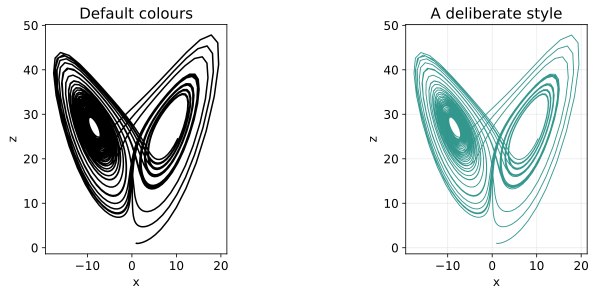
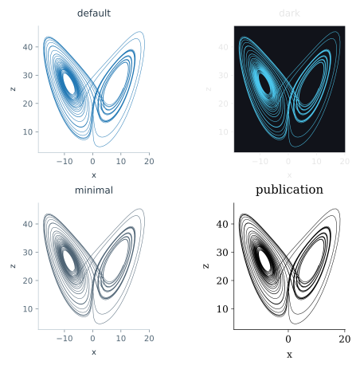

<span class="ts-kicker">Visualization · Styling & themes</span>

# Styling & themes

<div class="tsd-page-intro" markdown="1">

Use a theme for the whole figure, then change only what helps the reader: a
colour that separates two curves, a thinner line that reveals structure, or an
axis label that makes the units explicit. The data stays in the same `Plot`.

</div>

<!-- tsd-example: style-recipe -->
```python
import tsdynamics as ts

trajectory = ts.systems.Lorenz(ic=[1, 1, 1]).run(final_time=40, dt=0.02)
plain = ts.plot(trajectory, components=["x", "z"], title="Default colours")
plain.theme("publication", foreground="#273947").font(family="sans-serif", size=12)

styled = ts.plot(trajectory, components=["x", "z"], title="A deliberate style")
styled.theme("publication", foreground="#273947").font(family="sans-serif", size=12).recolor("#11857A")
styled.style(lw=0.9, alpha=0.85).gridlines(color="#94A0AA", alpha=0.2)
figure = (plain | styled).size(10, 4)
```

<figure class="tsd-showcase" markdown="1">
{ loading=lazy }
<figcaption>One trajectory, two presentations. The code above produces both
panels; colour, line weight and the grid change, while every data sample stays
the same.</figcaption>
</figure>

A theme supplies figure-wide defaults such as background, fonts and palette.
An explicit layer style takes precedence. Fluent methods mutate the plot and
return it, so a short chain is enough to keep related figures consistent.

```python
figure.relabel(title="Two presentations of one orbit")
figure[1].relabel(x="x", y="z")
```

For a composite, set the outer theme **before** panel-level palette, font or
grid overrides. A panel's own theme wins over the outer theme. Select a panel
with `figure[i]` when it needs its own labels or colour; use the composite's
`.size(...)` to set the exported figure's width and height in inches.

Supported styling carries across renderers, but the output is not pixel
identical. Features such as line dashes and font controls have backend-specific
support. The capability warning names an unsupported option rather than
leaving the difference unexplained. See [backends and export](backends.md).

## Start with the change you want

| I want to change… | Use |
|---|---|
| The whole figure's look | `.theme("publication")` or `.theme("dark")` |
| One curve's color or line weight | `.style(color="…", linewidth=…, layer=0)` |
| The colors across curves | `.palette(["#11857A", "#574FCF"])` |
| A scalar's colormap, range or colorbar | `.colorize(cmap="viridis", clim=(lo, hi), colorbar={"label": "…"})` |
| Labels and visible ranges | `.relabel(x="Time (s)", y="Voltage (mV)").limits(x=(0, 10))` |
| The legend's position | `.colorize(legend="upper right")` |
| One panel in a composite | `figure[0]` or nested `figure[0][1]`, then the same methods |
| An independent variant | `.copy()`, then edit the copy |

For complete figures with these changes already in place, start with the
[scientific recipes](recipes.md). The reference below lists the full vocabulary.

### Make a variant without changing the original

Fluent methods change the plot you call them on. Assignment alone gives a second
name to the same plot; `.copy()` gives you independent data, panels and settings.

```python
original = ts.plot(trajectory, components=["x", "z"], title="Reference view")
original.theme("publication").font(family="sans-serif")
zoom = original.copy().limits(x=(0, 18), y=(15, 45))
zoom.relabel(title="Detail").style(color="#11857A", linewidth=0.8)
comparison = (original | zoom).size(10, 4)
```

Copy a composite too when you want to change its panels independently. Copies
start without rendered backend objects, so each variant renders its own settings.

### Labels, guides and legends that explain the data

The axis label says *what* is measured; a guide identifies a meaningful value or
interval. These annotations use the panel's own data coordinates.

```python
trace = ts.plot(trajectory, "time_series", components="x", color="#11857A")
trace.relabel(x="Time", y="x", title="Retained observation window")
trace.hline(0, color="#6b7280", linestyle="dashed", linewidth=0.7)
trace.span(10, 20, color="#574FCF", alpha=0.12, label="inspection window")
trace.colorize(legend="upper right").gridlines(axis="y", alpha=0.2)
```

Set `labels=["reference", "perturbed"]` when plotting multiple subjects. For
one subject with multiple channels, the legend keeps each channel's name. Use
`.colorize(legend=False)` when labels would repeat information already on the axes.

### A scalar color needs its own meaning

`color=` selects a categorical ink color. `color_by=` maps a scalar per sample;
its colorbar should name that scalar, including units when available.

```python
colored = ts.plot(trajectory, components=["x", "y"], color_by=lambda tr: tr["z"])
colored.colorize(cmap="viridis", clim=(0, 50), colorbar={"label": "z", "location": "right"})
```

Use the same `clim` for panels that compare the same scalar. Use a linear color
scale for additive differences and a positive log scale for ratios across orders
of magnitude; zero and negative values cannot be shown on a log color scale.

## The style vocabulary

Pass these options directly to `ts.plot(...)` or to a plot's `.style(...)`
method. Short aliases work too. A backend that cannot draw an option warns;
the support column helps you choose an output that preserves your presentation.

| Canonical | Aliases | Honored by | Meaning |
| --- | --- | --- | --- |
| `color` | `c` | mpl, plotly, three.js | line / marker / fill colour (CSS name, hex, or rgb tuple) |
| `linewidth` | `lw` | mpl, plotly | line width, pt (≥ 0); WebGL lines remain one device pixel |
| `linestyle` | `ls` | mpl, plotly | one of `solid`, `dashed`, `dotted`, `dashdot` |
| `marker` | — | mpl, plotly | one of `circle`, `square`, `triangle`, `diamond`, `cross`, `x`, `star`, `none` |
| `markersize` | `ms`, `s` | mpl, plotly, three.js | marker size, pt (≥ 0) |
| `alpha` | `opacity` | mpl, plotly, three.js | opacity in `[0, 1]` |
| `cmap` | `colormap`, `colorscale` | mpl, plotly | colormap name for the colour / image channel |
| `fill` | — | mpl, plotly | fill the area under / between (bool) — `AREA` marks only |
| `fillalpha` | — | mpl, plotly | fill opacity in `[0, 1]` — `AREA` marks only |
| `zorder` | — | mpl, plotly, three.js | integer draw order (three.js maps it to `renderOrder`) |

The table follows the live `STYLE_KEYS` registry. You can inspect its accepted
names and backend support directly:

```pycon
>>> import tsdynamics as ts
>>> sorted(ts.viz.STYLE_KEYS)
['alpha', 'cmap', 'color', 'fill', 'fillalpha', 'linestyle', 'linewidth', 'marker', 'markersize', 'zorder']
>>> key = ts.viz.STYLE_KEYS["linewidth"]
>>> key.aliases, key.doc
(('lw',), 'line width (pt)')
>>> sorted(ts.viz.STYLE_KEYS["linestyle"].honored_by)
['matplotlib', 'plotly']
```

<details markdown="1">
<summary>Short spellings, validation and typo messages</summary>

### Aliases

Every key accepts the short spellings shown above. Short line styles
(`-`, `--`, `:`, `-.`) and marker symbols (`o`, `s`, `^`, `D`, `+`, `x`, `*`)
work too. Short and long spellings produce the same style:

```pycon
>>> from tsdynamics.viz import normalize_style
>>> normalize_style({"lw": 2, "c": "red", "s": 8, "ls": "--"})
{'linewidth': 2.0, 'color': 'red', 'markersize': 8.0, 'linestyle': 'dashed'}
```

(`marker` carries no *key-name* aliases — `STYLE_KEYS["marker"].aliases == ()` —
because its alternate spellings are the *value* aliases `o s ^ D + x *`,
accepted as values rather than alternate keyword names.)

### Validation

Values are coerced and range-checked by each key's validator. A bad value raises
`ValueError` at the call site rather than silently producing a broken plot:

```pycon
>>> normalize_style({"alpha": 1.5})
Traceback (most recent call last):
    ...
ValueError: invalid value for style key 'alpha': expected a value in [0, 1], got 1.5
```

The rules:

- Sizes (`linewidth`, `markersize`) must be **non-negative**.
- Opacities (`alpha`, `fillalpha`) must lie in **`[0, 1]`**.
- `zorder` must be a genuine **`int`** — a float `2.0` raises (no silent floor); a
  NumPy integer is accepted.
- A `bool` is **rejected** where a magnitude is expected — `alpha=True` is almost
  always a mistake, so it raises instead of quietly becoming `1.0`.

```pycon
>>> normalize_style({"zorder": 2.0})
Traceback (most recent call last):
    ...
ValueError: invalid value for style key 'zorder': expected an int, got 2.0
>>> normalize_style({"alpha": True})
Traceback (most recent call last):
    ...
ValueError: invalid value for style key 'alpha': expected a value in [0, 1], got bool True
```

### Unknown style keys {#unknown-keys-warn-they-are-never-silently-swallowed}

A typo or unsupported key is dropped with a warning that names the key and
lists accepted alternatives:

```pycon
>>> import warnings
>>> with warnings.catch_warnings(record=True) as w:
...     warnings.simplefilter("always")
...     normalize_style({"colour": "red", "lw": 2})
{'linewidth': 2.0}
>>> w[0].category.__name__
'VisualizationDegraded'
>>> str(w[0].message)
"unknown style key(s) dropped: 'colour'; known keys are alpha, cmap, color, fill, fillalpha, linestyle, linewidth, marker, markersize, zorder"
```

The same validation applies when creating a plot and when editing it with
`.style(...)`, so these options mean the same thing in both cases.

</details>

---

## Fluent tweak methods

Every tweak mutates the spec and **returns `self`**, so they chain top to bottom
and retain the same underlying data. Renderer support is described below. They split into three
groups: the **axis/label** tweaks, the **per-layer style** tweaks, and the
**figure-level theme** tweaks.

### Axis & label tweaks

These reshape the axes without touching the data or the look.

```python
p = (
    ts.plot(ts.systems.Rossler(ic=[0.1, 0.1, 0.1]), components=["x", "y"])
    .relabel(x="x(t)", y="y(t)", title="Rössler x–y")
    .limits(x=(-12, 12), y=(-12, 12))
    .ticks(x=[-10, 0, 10])
    .rescale(y="linear")
    .colorize(colorbar=False, legend=False)
)
```

| Method | Signature | What it does |
| --- | --- | --- |
| `.relabel` | `x=, y=, z=, title=` | set axis labels / title (only the args you pass; `z` ignored if 2-D) |
| `.rescale` | `x=, y=, z=` | axis scale — `"linear"` / `"log"` / `"symlog"` |
| `.limits` | `x=, y=, z=` | `(lo, hi)` view limits per axis |
| `.ticks` | `x=, y=, z=` | explicit tick locations per axis |
| `.colorize` | `clim=, colorbar=, legend=` | the colour range, and whether a colorbar / legend shows (each a `Colorbar`/`Legend` object or a `bool`) |

Each keyword defaults to "leave unchanged", so a tweak only touches what you name.

### `.style(**keys, layer=None, axes=None)` {#style}

Merge style keys into one layer or every layer. `**keys` go through
the same validation as the options passed when creating a plot.

```python
spec = ts.plot(ts.systems.Rossler(ic=[0.1, 0.1, 0.1]))

spec.style(color="teal", lw=2, alpha=0.8)   # apply to every layer
spec.style(linestyle="dotted", layer=0)     # apply to layer 0 only
spec.style(axes=False)                        # hide the axes entirely
```

`layer=None` (the default) applies to *every* layer; an `int` targets one layer.

`axes=False` hides ticks, labels, gridlines and 3-D panes. It works in
Matplotlib, Plotly and Threejs HTML. Use it for an illustrative orbit view;
retain coordinates when the figure needs to support quantitative comparisons.

### `.recolor(*colors, layer=None)` {#recolor}

The per-layer colour shorthand. With no `layer`, colour `i` is assigned to layer
`i`, cycling if there are more layers than colours; with an `int` layer, that one
layer is set to `colors[0]`:

```python
# Two 3-D attractors overlaid on one set of axes, coloured by source.
ts.plot(
    ts.systems.Lorenz(ic=[1.0, 1.0, 1.0]),
    ts.systems.Rossler(ic=[0.1, 0.1, 0.1]),
).recolor("crimson", "royalblue")
```

`.recolor("teal")` colors every layer teal. Use `layer=0` to select one layer;
multiple colors cycle through the layers in order. On a composite, tweaks recurse
through its panels; select `figure[i]` for a panel-specific change.

### `.theme(name | Theme, /, **overrides)` {#theme}

The figure-level look (palette / font / background / grid / line defaults). The
`theme` argument is positional-only: call `spec.theme("dark")`. Pass a registered name, a
`Theme` instance, or `None` (snapshot the active global default *now*), and
optionally override individual fields on top:

```python
spec.theme("publication")                     # a named built-in
spec.theme("dark", font_family="monospace")   # built-in + field override
spec.theme(None, line_width=2.0)              # global default + override
```

**Snapshot semantics.** `.theme("dark")` *pins* the dark theme onto the spec. A
spec that never calls `.theme(...)` carries no theme of its own and resolves to
the active global default **at render time** (so it tracks a later
[`themes.use`](#the-global-default)); calling `.theme(...)` — even
`.theme(None, ...)` — materialises a concrete theme now and **detaches** the spec
from future global-default changes. You can always read the effective theme back:

```pycon
>>> import tsdynamics as ts
>>> ts.plot(ts.systems.Lorenz(ic=[1.0, 1.0, 1.0])).resolved_theme.name
'default'
>>> ts.plot(ts.systems.Lorenz(ic=[1.0, 1.0, 1.0])).theme("dark").resolved_theme.name
'dark'
```

Read the effective theme through `spec.resolved_theme`.

### `.palette`, `.gridlines`, `.font`, `.background`, `.size` {#palette-grid-font-background-size}

Conveniences that each touch one facet of the theme (or, for `.size`, the figure
geometry). All are theme overrides layered on the resolved theme, so they compose
with `.theme(...)` and with each other:

```python
spec.palette(["#11857A", "#574FCF", "#E8A33D"])  # explicit colour cycle
spec.palette("dark")                              # borrow a registered theme's palette
spec.gridlines(show=True, axis="y", color="#9aa7b0", alpha=0.3)  # y-axis gridlines, styled
spec.font(family="serif", size=12)                # theme font family / size
spec.background("#0b1020")                         # figure / axes facecolor
spec.size(width=8, height=5, dpi=150)              # inches, at 150 dots per inch
```

Notes:

- **`.size` uses inches** for width and height, as matplotlib does. For pixel
  dimensions at export, use `spec.save("figure.png", size=(1200, 750), dpi=150)`.

- **`.palette`** accepts a registered theme *name* (borrows its palette), a bare
  colour string (a one-colour palette), or an explicit sequence — the same
  `resolve_palette` logic:

  ```pycon
  >>> from tsdynamics.viz.style import resolve_palette
  >>> resolve_palette("dark")[0]          # borrow the dark palette
  '#4cc9f0'
  >>> resolve_palette("#ff0000")          # a bare colour → a one-colour cycle
  ('#ff0000',)
  ```

- **`.gridlines`** toggles gridlines on `"x"` / `"y"` / `"both"` (default `"both"`);
  passing `color=` / `alpha=` also sets the theme's `grid_color` / `grid_alpha`
  so the styling is shared across the figure.
- **`.size`** is deliberately **not** a theme field — `figsize` / `dpi` are figure
  geometry, stored in `spec.meta` (`meta["figsize"]`, `meta["dpi"]`). Only the
  dimensions you pass are updated.

### Chaining

Because every tweak returns `self`, a full figure recipe reads top to bottom —
axes, then look, then geometry:

```python
p = (
    ts.plot(ts.systems.Lorenz(ic=[1.0, 1.0, 1.0]), components=["x", "z"])
    .relabel(x="x(t)", y="z(t)", title="Lorenz x–z")
    .theme("dark")
    .gridlines(color="#3a3f4b", alpha=0.6)
    .recolor("#4cc9f0")
    .style(lw=1.6, alpha=0.9)
    .font(family="monospace")
    .size(width=7, height=7)
)
p.save("lorenz.png")       # matplotlib, by extension — honors the whole chain
```

Note the extension. Saving this same chain as `.html` routes to plotly, which
does not honor `figsize` (see the honoring table above), so the `.size(...)` step
would produce a `VisualizationDegraded` warning naming it. Choose the export
backend before relying on backend-specific sizing.

The static tweaks compose with the [animation](animation.md) modifiers
(`.animate` / `.trail` / `.head` / `.camera` / `.clock`) the same way — they are
all mutate-and-return-self, so a static recipe and a movie recipe are the same
chain with a `.animate(...)` appended.

---

## Themes

A `Theme` is a **frozen** dataclass describing the figure-level look applied
*before* per-layer style:

| Field | Meaning |
| --- | --- |
| `palette` | colour cycle for auto-coloured layers (those with no explicit `color`) |
| `background` | figure / axes facecolor |
| `foreground` | default ink — text / axes / ticks colour |
| `font_family`, `font_size`, `title_size` | typography |
| `grid`, `grid_color`, `grid_alpha` | default gridline visibility / look |
| `line_width`, `marker_size` | default line / marker sizes |
| `figsize`, `dpi`, `layout_engine` | figure geometry — honoured by matplotlib; plotly declines them with a `VisualizationDegraded` |

Because it is frozen it is safe to share and cache, and you never have to build
one: `ts.viz.themes.register(name, **fields)` takes the keywords directly, and
returns the built theme if you want it. Deriving from an existing theme is the
same call with the original passed positionally:

```python
lab = ts.viz.themes.register("lab", ts.viz.themes.get("minimal"),
                             palette=("#0b6", "#e63"), font_family="serif")
lab.background          # the built theme, if you want the object
ts.viz.themes.get("minimal").palette   # ...and the original is untouched
```

### The built-in themes

Four themes ship out of the box, applied per figure with `.theme(...)`:

| Theme | Look |
| --- | --- |
| `default` | light background, a clean 10-colour qualitative palette, sans-serif, grid off |
| `dark` | near-black background (`#11131a`), light ink (`#e6e6e6`), a brighter 10-colour palette |
| `minimal` | light, a muted palette, slightly thinner lines (`line_width=1.2`), grid off |
| `publication` | serif font, larger labels / titles (`font_size=12`, `title_size=15`), a colourblind-safe palette (Wong 2011, 8 hues) |

<figure markdown>
{ loading=lazy }
<figcaption>One Lorenz <code>(x, z)</code> portrait, four themes, tiled with <code>ts.plot(..., layout="grid")</code>. Only the theme differs between panels: <b>default</b> (matplotlib-ish blue on white), <b>dark</b> (bright cyan on <code>#11131a</code> — the panel keeps its near-black background through the composite), <b>minimal</b> (muted slate), and <b>publication</b> (serif labels, larger type, the colourblind-safe Wong palette). Switching theme is a one-word change to the recipe.</figcaption>
</figure>

```pycon
>>> import tsdynamics as ts
>>> ts.viz.themes.names()
['dark', 'default', 'minimal', 'publication']
>>> ts.viz.themes.get("publication").font_family, ts.viz.themes.get("publication").title_size
('serif', 15.0)
>>> ts.viz.themes.get("dark").background, ts.viz.themes.get("dark").palette[0]
('#11131a', '#4cc9f0')
```

Apply one and save straight to a paper-ready vector:

```python
ts.plot(ts.systems.Lorenz(ic=[1.0, 1.0, 1.0])).theme("publication").save("lorenz-pub.pdf")
```

### Registering your own

**`ts.viz.themes.register(name, **fields)` takes plain keywords** — there is no
library type to build. The theme then joins `themes.names()` and is reachable by
name everywhere a name is accepted (`.theme("mine")`, `.palette("mine")`,
`themes.use("mine")`):

```python
ts.viz.themes.register(
    "tsd-brand",
    palette=("#11857A", "#574FCF", "#E8A33D", "#C2405A"),  # teal · indigo · amber · rose
    background="#faf7f2",
    foreground="#1c2b2d",
    font_family="serif",
    grid=True,
    grid_color="#9aa7b0",
    grid_alpha=0.35,
    line_width=1.6,
)

ts.plot(ts.systems.Lorenz(ic=[1.0, 1.0, 1.0])).theme("tsd-brand")   # usable by name
```

Derive one from a built-in by passing it positionally and overriding fields:

```python
ts.viz.themes.register("paper", ts.viz.themes.get("publication"),
                       font_family="serif", dpi=600)
```

```pycon
>>> ts.viz.themes.names()                       # after registering
['dark', 'default', 'minimal', 'paper', 'publication', 'tsd-brand']
>>> ts.viz.themes.get("tsd-brand").background
'#faf7f2'
```

`register` returns the new `Theme` for reuse or inspection.

A registered theme is the right home for your lab's or paper's house style — set
it once, then every figure is one `.theme("tsd-brand")` (or one
[`themes.use`](#the-global-default)) away.

### The global default

`themes.use` / `themes.get` read and write the **single** mutable global in the viz
layer for theme selection — the active default theme that any spec *without its own theme* resolves to
at render time:

```pycon
>>> ts.viz.themes.get().name          # the active default
'default'
>>> ts.viz.themes.use("dark")         # every un-themed plot is now dark
>>> ts.viz.themes.get().name
'dark'
>>> ts.viz.themes.use("default")      # back to baseline
```

`themes.use` accepts a registered *name* or a `Theme` *instance* (which it
registers and activates in one step). `themes.use("default")` always returns to
the baseline. Because a spec that never called `.theme(...)` resolves **lazily**,
switching the global default re-themes every such spec on its next render — set it
once at the top of a notebook or script and every plot follows:

```python
ts.viz.themes.use("publication")
ts.plot(ts.systems.Lorenz(ic=[1.0, 1.0, 1.0])).save("fig1.pdf")   # publication-themed
ts.plot(ts.systems.Rossler(ic=[0.1, 0.1, 0.1])).save("fig2.pdf")  # …and so is this
ts.viz.themes.use("default")                                      # tidy up
```

!!! tip "Global vs. pinned"
    Use **`themes.use(...)`** for a document-wide default that every un-themed
    plot should follow, and **`.theme(...)`** to pin one figure regardless of the
    global. A pinned plot ignores a later `themes.use`; an un-pinned one tracks
    it.

---

## Per-backend honoring

Visual backends support different styling options. Each `StyleKey` records
its support in `honored_by`. One consolidated `VisualizationDegraded` warning
lists unsupported options at render time. The JSON exporter preserves the
settings instead of drawing them.

| Style key | matplotlib | plotly | three.js |
| --- | :---: | :---: | :---: |
| `color` | ✓ | ✓ | ✓ |
| `linewidth` | ✓ | ✓ | — (one device pixel) |
| `markersize` | ✓ | ✓ | ✓ |
| `alpha` | ✓ | ✓ | ✓ |
| `zorder` | ✓ | ✓ | ✓ (→ `renderOrder`) |
| `linestyle` | ✓ | ✓ | — |
| `marker` (shape) | ✓ | ✓ | — (points only) |
| `cmap` | ✓ | ✓ | — (fixed ramp) |
| `fill`, `fillalpha` | ✓ | ✓ | — |

The notable gaps:

- **three.js** does not honor line width, `linestyle`, marker *shape*, or an arbitrary
  `cmap` — it draws solid lines, points (size honored, shape not), and a fixed
  built-in colour ramp.
- **`fill` / `fillalpha`** apply to `AREA` marks (a band, a filled region) only.

When a backend would drop something, it tells you — in one message per render,
listing the dropped keys alphabetically:

```pycon
>>> import warnings
>>> import tsdynamics as ts
>>> spec = ts.plot(ts.systems.Lorenz(ic=[1.0, 1.0, 1.0])).style(
...     linestyle="dashed", marker="square", cmap="viridis"
... )
>>> with warnings.catch_warnings(record=True) as w:
...     warnings.simplefilter("always")
...     _ = spec.render("threejs")
>>> str(w[0].message)
'threejs: ignoring cmap, linestyle, marker'
```

The message also covers unsupported animation options and theme fields.
Render this example with Matplotlib or Plotly to retain those styles. You can introspect a key's reach up front:

```pycon
>>> sorted(ts.viz.STYLE_KEYS["linestyle"].honored_by)
['matplotlib', 'plotly']
>>> sorted(ts.viz.STYLE_KEYS["color"].honored_by)
['matplotlib', 'plotly', 'threejs']
```

For styling shared with three.js, prefer `color` /
`markersize` / `alpha` / `zorder`, which every backend honors.

---

<details markdown="1">
<summary>Older versions, strict warning handling and style introspection</summary>

## Upgrading from v3 — breaking changes

Since v5, style values are validated against the options listed on this page.
Some Matplotlib-specific values accepted in v3 now raise `ValueError`; replace
them with a supported value below. A valid option that a chosen backend cannot
draw produces a capability warning instead.

```python
# skip-doctest — the first call deliberately shows what now RAISES
# v3 — forwarded to matplotlib, silently accepted
spec.style(marker="v", linestyle=(0, (3, 1)), alpha=1.5, zorder=2.0)

# v5 — each of these raises ValueError; map to the canonical set
spec.style(marker="triangle", linestyle="dashed", alpha=1.0, zorder=2)
```

### Markers — canonical shapes only

`marker` is the canonical set `circle`, `square`, `triangle`, `diamond`, `cross`,
`x`, `star`, `none`, plus the single-character aliases `o s ^ D + x *`. The
matplotlib-only spellings with **no** canonical equivalent now raise:

| v3 matplotlib marker | v5 — use instead |
| --- | --- |
| `'v'`, `'<'`, `'>'` (oriented triangles) | `"triangle"` |
| `'^'` | `"triangle"` (kept as an alias — still works) |
| `'d'` (thin diamond) | `"diamond"` |
| `'8'` (octagon) | `"circle"` (nearest) |
| `'P'` (filled plus) | `"cross"` |
| `'p'`, `'h'`, `'H'` (pentagon / hexagons) | `"star"` or `"circle"` (nearest) |

Unsupported marker values raise `ValueError`; they are not substituted.
Threejs draws points without preserving marker shape, while JSON stores the
requested style for later rendering.

### Linestyles — named set only

`linestyle` is the named set `solid`, `dashed`, `dotted`, `dashdot`, plus the
short aliases `- -- : -.`. The matplotlib **dash-tuple** form (e.g.
`(0, (3, 1, 1, 1))`) now raises — pick the nearest named style:

```python
# skip-doctest — the first line deliberately shows what now RAISES
spec.style(linestyle=(0, (5, 2)))   # v3 — raises ValueError now
spec.style(linestyle="dashed")      # v5
```

### Range / type checks

Values are now coerced and range-checked, so out-of-range or wrong-typed values
v3 tolerated raise:

- `alpha` / `fillalpha` must lie in `[0, 1]` — v3 tolerated `alpha > 1`
  (matplotlib clamped it).
- `linewidth` / `markersize` must be `≥ 0`.
- `zorder` must be an **integer** — a float `2.0` raises (v3 silently floored it
  via `int(...)`); a NumPy integer is accepted.
- A `bool` is rejected where a magnitude is expected (`alpha=True`,
  `linewidth=True`).

Unknown keys — including a near-miss typo like `colour=` — are **not** a fatal
error: they are dropped with a single `VisualizationDegraded` warning naming the
offending key(s) (see [*Unknown keys warn*](#unknown-keys-warn-they-are-never-silently-swallowed),
above), so the silent no-op of v3 (`colour='red'` did nothing) is gone.

---

## Interaction with `filterwarnings = ["error"]`

This repo's own pytest policy is `filterwarnings = ["error"]` — every warning
becomes an exception — and a fair number of downstream projects run the same
strict policy. Under it, the **two warning paths** the styling layer adds turn
into *errors*:

1. **An unknown style key.** `.style(unknown_key=...)` (or any `normalize_style`
   call that drops a key) emits a `VisualizationDegraded`. With warnings as
   errors, `.style(colour="red")` *raises* instead of warning-and-dropping.
2. **An unsupported option at render time.** Rendering a spec that sets an option the
   chosen backend cannot honor (e.g. `linestyle` on three.js) emits the
   consolidated `VisualizationDegraded` described above — which becomes an error
   under the strict policy.

A plot using only supported options does not produce this style warning.
Other warnings, such as geometry thinning, have separate causes.

If a downstream test treats warnings as errors and you *want* the degraded path
(you know three.js drops `linestyle`, say), scope the warning rather than
loosening your global policy. The warning class is
`tsdynamics.viz.render.caps.VisualizationDegraded`:

```python
import warnings
from tsdynamics.viz.render.caps import VisualizationDegraded

# 1. Swallow it locally
with warnings.catch_warnings():
    warnings.simplefilter("ignore", VisualizationDegraded)
    spec.style(linestyle="dashed").render("threejs")
```

```python
# 2. Assert it in a test (pytest), which also consumes it so it can't escalate
import pytest

with pytest.warns(VisualizationDegraded):
    spec.style(colour="red")            # the typo path
```

```ini
# 3. Or down-grade just this class in pyproject.toml / pytest.ini
[tool.pytest.ini_options]
filterwarnings = [
    "error",
    "ignore::tsdynamics.viz.render.caps.VisualizationDegraded",
]
```

Prefer the narrowest scope that fits — `catch_warnings` / `pytest.warns` around
the one call, not a project-wide ignore — so a genuinely-unintended degradation
still surfaces everywhere else.

---

## Introspection

The whole styling surface is discoverable from `tsdynamics.viz`:

| Entry point | What it gives |
| --- | --- |
| `ts.viz.STYLE_KEYS` | the canonical vocabulary — `name → StyleKey` (each with `aliases`, `honored_by`, `validate`, `doc`) |
| `ts.viz.normalize_style` | normalize short names and validate style values |
| `ts.viz.themes.names()` | sorted names of all registered themes |
| `ts.viz.themes.get()` / `ts.viz.themes.use()` | read / write the active global default |
| `ts.viz.themes.register()` | add a named theme |
| `ts.viz.Theme` | the theme dataclass |

```pycon
>>> import tsdynamics as ts
>>> sorted(ts.viz.STYLE_KEYS)
['alpha', 'cmap', 'color', 'fill', 'fillalpha', 'linestyle', 'linewidth', 'marker', 'markersize', 'zorder']
>>> key = ts.viz.STYLE_KEYS["markersize"]
>>> key.aliases, key.doc
(('ms', 's'), 'marker size (pt)')
```

`ts.viz` is bound **lazily** — a plain `import tsdynamics` pulls in no plotting
library — so reach the styling API through the `ts.viz` namespace (it resolves and
caches on first access).

</details>

---

## See also

- [Scientific recipes](recipes.md) — complete figures to copy and customize
- [Visualization overview](index.md) — the plotting workflow and available renderers
- [Animation](animation.md) — the animation modifiers
  (`.animate`/`.trail`/`.head`/`.camera`/`.clock`) that chain with these tweaks,
  and the honoring gaps for the web exporter
- [Lyapunov spectra](../analysis/lyapunov.md) — an example of a result that
  describes itself as a stylable `Plot`

## References

- B. Wong, "Points of view: Color blindness", *Nature Methods* **8** (2011) 441
  — the colourblind-safe palette used by the `publication` theme.
